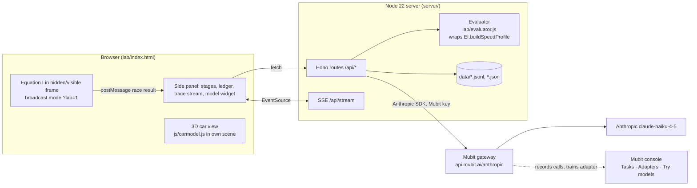

# PURPLE — Architecture

> Status: describes the first-night research lab (`/lab/`, no longer linked from the site); the current product is in [README.md](../README.md). The §9 list of game files the project may touch still applies.

Version 1.0 · 2026-10-23 · Single source of truth for data shapes, routes, the aero map, the Mubit contract and the game changes. If another doc disagrees with this one, this one wins.

## 1. Overview



The game is untouched except for three opt-in hooks (§9). The lab is a new folder. Mubit is only ever called from the server.

## 2. Stack

| Layer | Choice | Why |
|---|---|---|
| Game | Equation I as-is: plain JS, three.js r128, no build step, static | It works; a build step is a risk we don't need |
| Lab UI | Plain JS + the game's own `EI.*` globals, one `lab/index.html`, one `lab/lab.js`, one `lab/lab.css` | Same conventions as the game; loads `js/carmodel.js` for the 3D view |
| Evaluator | `lab/evaluator.js`, plain JS, runs in **both** browser and Node (UMD-style: attaches to `window.EI` or `module.exports`) | One implementation, no drift between panel and server |
| Server | Node 22, `hono@4` + `@hono/node-server`, `@anthropic-ai/sdk` (latest 0.x), `dotenv` | Tiny, fast to write, streams SSE easily |
| Storage | Append-only JSONL files in `data/` | Reproducible, greppable, zero setup, survives restarts |
| LLM | `claude-haiku-4-5` via Mubit Anthropic path, temperature 0, `max_tokens: 400` | Fast, consistent JSON; consistency is what the adapter learns |
| Game runtime for evaluator in Node | `jsdom` is **not** used; the evaluator only needs `EI.U`, `EI.CAR` constants and track data, loaded by `server/game-headless.js` with a THREE stub | `track.js` builds meshes; we only need `lineK`, `ds`, `n`, `sectors`, `grade`, so the headless loader stubs `THREE` with no-op classes |
| Deploy | Demo laptop runs the server on `:8787` and serves the static site; Vercel keeps serving the public game | Nothing cloud-side can break at 12:30 Sunday |

Pinned in `package.json`; `npm ci` must work from a clean clone. Verify versions in `P0.T1`.

## 3. Boundaries

| Concern | Lives in | Never in |
|---|---|---|
| Physics constants, bot calibration | `js/car.js`, `js/ai.js` (game) | lab code — the lab passes multipliers, never edits constants |
| Aero map (setup → multipliers) | `lab/aero.js` | prompts, UI |
| Lap-time evaluation | `lab/evaluator.js` | the LLM — the model never computes times |
| Decisions | the research agent via `/api/plan` | the evaluator — the evaluator never decides |
| Rules (corrections) | `data/rules.json`, read by the server at request time | the system prompt (it is frozen) |
| Mubit key | server env only | browser, repo, logs |

## 4. Data model

All times in seconds (float, 3 dp). All IDs are `ULID` strings. Files are JSONL except `rules.json` and `exam.json`.

### 4.1 `Setup` (F-01)
```json
{
  "front_wing_deg": 25,
  "rear_wing_deg": 20,
  "ride_height_mm": 35,
  "brake_bias_pct": 57,
  "ers_deploy": 0.5
}
```
| Field | Range (regulation subset) | Baseline | Rule ID on violation |
|---|---|---|---|
| `front_wing_deg` | 10–40 | 25 | `REG-FW-MIN` / `REG-FW-MAX` |
| `rear_wing_deg` | 5–35 (TD-01 caps at 20 when active) | 20 | `REG-RW-MIN` / `REG-RW-MAX` / `TD-01` |
| `ride_height_mm` | 25–60 | 35 | `REG-RH-MIN` / `REG-RH-MAX` |
| `brake_bias_pct` | 52–62 (front share) | 57 | `REG-BB-MIN` / `REG-BB-MAX` |
| `ers_deploy` | 0.00–1.00 (0 = spend on every straight, 1 = save for attack) | 0.5 | `REG-ERS` |

### 4.2 `Conditions`
```json
{ "circuit": "silverstone", "wet": false, "wind_ms": 0, "wind_from_deg": 0 }
```
`circuit` ∈ `silverstone | monza`. `wind_from_deg` is compass direction the wind blows **from** (0 = north), used against the track heading per segment.

### 4.3 `AeroMultipliers` (F-01) (output of `lab/aero.js`)
```json
{ "df": 1.0, "cd": 1.0, "a0": 1.0, "b0": 1.0, "legal": true, "violations": [] }
```

### 4.4 `Evaluation` (F-02)
```json
{
  "lap": 80.812, "sectors": [27.104, 31.560, 22.148],
  "vmax_kmh": 331.2, "vmin_kmh": 128.4,
  "terminal_kmh": 331.2,
  "delta_lap": -0.214, "delta_sectors": [0.051, -0.302, 0.037],
  "legal": true, "violations": [],
  "model": "reduced-order lap model · calibrated to 2026 pole laps · aero map v1"
}
```
`delta_*` are candidate minus baseline (negative = faster). Every evaluation of a candidate also evaluates the baseline under the same `Conditions`.

### 4.5 `Scenario` (F-03) (the research agent's input — keep under 350 tokens)
```json
{
  "objective": "min lap",
  "circuit": "silverstone",
  "conditions": { "wet": false, "wind_ms": 0 },
  "baseline": { "front_wing_deg": 25, "rear_wing_deg": 20, "ride_height_mm": 35, "brake_bias_pct": 57, "ers_deploy": 0.5, "lap": 80.812, "sectors": [27.104, 31.560, 22.148], "vmax_kmh": 331 },
  "candidate": { "front_wing_deg": 25, "rear_wing_deg": 28, "ride_height_mm": 35, "brake_bias_pct": 57, "ers_deploy": 0.5 },
  "result": { "delta_lap": 0.188, "delta_sectors": [-0.094, 0.311, -0.029], "vmax_kmh": 321, "vmin_kmh": 133, "legal": true },
  "rules": ["Weigh straight-line drag against corner gain; judge on full-lap delta."],
  "history": [{ "change": "rear_wing_deg +4", "delta_lap": 0.071 }]
}
```
`history` holds at most the last 3 experiments as one-line summaries.

### 4.6 `PlanOutput` (F-03) (the research agent's output — strict JSON, nothing else)
```json
{
  "verdict": "reject",
  "next_parameter": "rear_wing_deg",
  "direction": "decrease",
  "magnitude": 4,
  "expected_sector_effect": [0.05, -0.20, 0.03],
  "hypothesis": "Silverstone's long straights punish drag more than Maggotts rewards load.",
  "reject_if": "delta_lap > 0"
}
```
| Field | Type | Constraint |
|---|---|---|
| `verdict` | enum | `promote` (candidate becomes new baseline) · `reject` · `retest` (run again in other conditions) |
| `next_parameter` | enum | one of the five `Setup` keys |
| `direction` | enum | `increase` · `decrease` |
| `magnitude` | number | within the parameter's range; wings and ride height in whole units, `ers_deploy` in 0.1 steps |
| `expected_sector_effect` | number[3] | seconds, candidate minus baseline |
| `hypothesis` | string | ≤ 160 chars |
| `reject_if` | string | ≤ 80 chars, a condition on `Evaluation` fields |

### 4.7 `Experiment` (F-06) (ledger row, `data/ledger.jsonl`)
```json
{
  "id": "01JB…", "created_at": "2026-10-24T09:12:03Z", "seed": 4821,
  "scenario": {…}, "evaluation": {…}, "plan": {…},
  "mubit_request_id": "mreq_…", "session_id": "exp-01JB…", "latency_ms": 812,
  "status": "planned | raced | overruled | parse_error",
  "measured": { "baseline": { "lap": 80.9, "sectors": [27.2, 31.5, 22.2] }, "candidate": { "lap": 81.1, "sectors": [27.1, 31.8, 22.2] }, "agreement_pct": 18 },
  "overrule": { "verdict": "reject", "reason": "…", "rule_id": "R-01", "by": "engineer" }
}
```

### 4.8 `Rule` (F-05) (`data/rules.json`, array)
```json
{ "id": "R-01", "text": "Weigh straight-line drag against corner gain; judge on full-lap delta.", "created_at": "…", "from_experiment": "01JB…", "active": true }
```

### 4.9 `Call` (`data/calls.jsonl`) — one row per Mubit call: `{ id, kind: "plan|exam|smoke", session_id, mubit_request_id, model, input_tokens, output_tokens, latency_ms, status, trained: true|false }`. `trained = false` means the call carried `x-middleware-record: metadata`.

### 4.10 `ExamScenario` (`data/exam.json`, 20 items): `{ id, scenario, truth: { verdict, next_parameter, direction } }`. Truth is computed: `verdict = delta_lap < -0.03 ? "promote" : delta_lap > 0.03 ? "reject" : "retest"`; `next_parameter/direction` = the single ±1-step change with the best evaluator lap.

## 5. API (server, base `http://localhost:8787`)

All responses are JSON `{ ok: true, data }` or `{ ok: false, error: { code, message } }`. No auth (single-user demo). Error codes: `BAD_INPUT` 400, `ILLEGAL_SETUP` 422, `MUBIT_ERROR` 502 (body carries Mubit's `code`), `PARSE_ERROR` 502, `NOT_FOUND` 404.

| Route | Body → Data | Notes |
|---|---|---|
| `POST /api/evaluate` | `{ setup, conditions }` → `Evaluation` | Pure; never calls Mubit. 422 if illegal. |
| `POST /api/plan` | `{ scenario_overrides? }` → `Experiment` | Builds the scenario from current baseline + a generated or supplied candidate, evaluates, calls Mubit, appends ledger + calls rows, emits SSE `plan`. Idempotent per `client_id` (header `x-client-id`) for 10 s. |
| `POST /api/promote` | `{ experiment_id }` → `{ baseline }` | Candidate becomes baseline. |
| `POST /api/overrule` | `{ experiment_id, verdict, reason }` → `{ rule }` | Appends a `Rule`, marks the experiment `overruled`, emits SSE `rule`. Rule text is the reason, trimmed to 160 chars. |
| `POST /api/race/result` | `{ experiment_id, seed, cars: [{ role, lap, sectors, vmax_kmh, vmin_becketts_kmh }] }` → `Experiment` | Posted by the game iframe via the lab page. Computes `agreement_pct`. |
| `GET /api/ledger?limit=50` | → `Experiment[]` newest first | |
| `GET /api/rules` | → `Rule[]` | |
| `POST /api/rules/:id` | `{ active }` → `Rule` | Toggle; used by the technical-directive demo. |
| `GET /api/status` | → `{ task_name, kept_examples, adapter_version, test_result, exam: { provider, v1, v2 } }` | Values entered by hand from the console via `POST /api/status`. |
| `POST /api/status` | partial of the above → same | The widget's source of truth. |
| `POST /api/exam/run` | `{}` → `{ provider: n, total: 20 }` | Runs 20 exam calls with `trained=false`. |
| `POST /api/collect` | `{ n, with_rules }` → `{ sent, kept_hint }` | Scenario generator + sequential plan calls, concurrency 2, for building examples. |
| `GET /api/stream` | SSE events: `plan`, `rule`, `race`, `status`, `error` | Payload is the full object each time. |

## 6. Data flow — one experiment

1. UI `POST /api/plan`. Server picks the candidate: either the agent's previous `next_parameter/direction/magnitude` applied to the baseline, or a random legal perturbation for collection.
2. `aero.toMultipliers(setup)` → legality. An illegal candidate is never sent to the agent: the server returns 422 `ILLEGAL_SETUP` with the violation IDs, logs a `calls.jsonl` row with `kind: "illegal"` (no Mubit call), and the generator picks another candidate. During the technical-directive demo the UI shows the violation on the DESIGN card.
3. `evaluator.evaluate(circuit, setup, conditions)` for candidate and baseline → `Evaluation`.
4. Scenario assembled (§4.5), rules from `rules.json` where `active`.
5. Anthropic SDK call through Mubit (§7). Response text → JSON parse → validate against `PlanOutput`. On failure: retry once with the same input; then `parse_error`.
6. Append `Experiment` to `ledger.jsonl`, `Call` to `calls.jsonl`, emit SSE.
7. UI: DESIGN card shows the plan; EVALUATE card shows numbers; "Race it" opens the game iframe with `?lab=1&seed=…&baseline=<b64>&candidate=<b64>&laps=3&circuit=silverstone`.
8. Game posts `{ type: "purple:result", … }` via `window.parent.postMessage`; the lab page forwards to `POST /api/race/result`.
9. Engineer presses Overrule → `POST /api/overrule` → rule active → next scenario includes it.

## 7. Integrations

### 7.1 Mubit (the only external call)

```js
import Anthropic from "@anthropic-ai/sdk";
const client = new Anthropic({ baseURL: "https://api.mubit.ai/anthropic", apiKey: process.env.MUBIT_API_KEY });
const msg = await client.messages.create({
  model: "claude-haiku-4-5",
  max_tokens: 400,
  temperature: 0,
  system: SYSTEM_PROMPT,                      // lab/prompt.js — FROZEN, version in header comment
  messages: [{ role: "user", content: JSON.stringify(scenario) }],
  metadata: { user_id: sessionId },           // one per experiment: "exp-<ulid>"
}, { headers: trained ? {} : { "x-middleware-record": "metadata" } });
const requestId = msg._request_id ?? headersOf(msg)["x-middleware-request-id"];
```
Use `.withResponse()` to read `x-middleware-request-id`. Rules that keep the task stable:
- System prompt, model, `max_tokens` shape, no tools, no `response_format`: never change after the first call. The task key = system prompt + tools + tool choice + output format + model.
- Everything variable goes in the user message.
- Concurrency ≤ 2 (`starter_credit_busy` is a 429 with `retry-after`; honour it, retry once).
- Calls that must not train (exam, smoke tests, debugging): header `x-middleware-record: metadata`.
- Never from the browser (no CORS). Never log the key.

### 7.2 The frozen system prompt (`lab/prompt.js`)

```text
You are the research engineer of an F1 setup lab. You receive one experiment as JSON: the baseline setup and its lap, a candidate setup, the evaluator's measured result (lap and sector deltas, candidate minus baseline; negative is faster), active pit-wall rules, and up to three past experiments. Decide the verdict and the single next experiment.
Return ONLY a JSON object with exactly these keys: verdict ("promote"|"reject"|"retest"), next_parameter (one of front_wing_deg, rear_wing_deg, ride_height_mm, brake_bias_pct, ers_deploy), direction ("increase"|"decrease"), magnitude (number), expected_sector_effect (array of 3 numbers in seconds), hypothesis (string, max 160 chars), reject_if (string, max 80 chars).
Promote only if delta_lap < -0.03. Reject if delta_lap > 0.03. Otherwise retest. Follow every active rule. No prose outside the JSON.
```
The prompt deliberately does **not** mention drag-vs-downforce priorities: that is what the human teaches via rules, so v2 differs from v1.

### 7.3 Equation I (in-repo)
Loaded by the lab page as plain scripts in the same order as `index.html`. Hooks used: `EI.buildSpeedProfile` (exposed in P0.T3), `EI.carModel` (3D), the game's `?lab=1` broadcast mode (P1.T2).

## 8. The aero map (F-01) (`lab/aero.js`) — reduced-order, documented, labelled

Baseline multipliers are all 1.0. Per-unit sensitivities (chosen to reproduce published F1 setup folklore: ~0.5–1.0 % lap per 2° of rear wing at Silverstone, straight-line loss ~3 km/h per 2°):

| Parameter | Effect on `df` | Effect on `cd` | Other |
|---|---|---|---|
| `rear_wing_deg` (per ° from 20) | +0.018 | +0.011 | |
| `front_wing_deg` (per ° from 25) | +0.010 | +0.004 | balance term below |
| `ride_height_mm` (per mm from 35) | −0.006 (lower = more floor load) | 0 | below 30 mm: `a0 *= 1 − 0.012·(30 − rh)` (bottoming) |
| `brake_bias_pct` (per % from 57) | 0 | 0 | `b0 *= 1 − 0.004·|bb − 57|` |
| `ers_deploy` | 0 | 0 | sets the bot's `ers` trait; evaluator ignores it (mode 1 = no ERS) |

Balance: `imb = 0.6·(fw − 25) − 0.4·(rw − 20)` (degrees of front/rear mismatch); `a0 *= 1 − 0.004·|imb|`. Clamp all multipliers to `[0.6, 1.6]`.

Physics mapping (used identically by evaluator and game): `CD·cd`, `GRIP.a1·df`, `BRAKE.b1·df`, `GRIP.a0·a0`, `BRAKE.b0·b0`. Terminal speed for a setup: `VMAX · cd^(-1/3)` (from `PM/v − CD·cd·v² = 0`).

Conditions: `wet` → `a0 *= 0.82`, `df *= 0.90`, `b0 *= 0.85`. Wind → for each track sample `i`, `w_i = wind_ms · cos(heading_i − wind_to)`; drag term uses `(v + w_i)·|v + w_i|` in the forward pass and the terminal-speed cap becomes per-sample.

## 9. Game changes (F-04, F-07) (all opt-in, default behaviour identical)

| File | Change | Lines (current) |
|---|---|---|
| `js/car.js` | `this.aero = opts.aero || { df: 1, cd: 1, a0: 1, b0: 1 }`; use `CD * this.aero.cd` in the drag line, `GRIP.a0 * a0`/`GRIP.a1 * df` in the lateral limit, `BRAKE.b0 * b0`/`BRAKE.b1 * df` in braking | 5–7, 197–198, 214 |
| `js/ai.js` | `buildSpeedProfile(track, dec, grip, ceil, mode, chi, aero, wind)` reads `G.a0*aero.a0`, `G.a1*aero.df`, `B.*`, `CD*aero.cd`; `profileFor` includes `aero` + `wind` in its cache key; `profileLap` caps at the setup's terminal speed; export `EI.buildSpeedProfile`, `EI.profileLap` | 273–319 |
| `js/main.js` | `?lab=1` → `readConfig` from URL (`seed`, `laps`, `circuit`, `baseline`, `candidate`, `driver`), `players: []`, TV camera, no intro, auto-start; on `race.on('finish')` post `purple:result` to `window.parent` with best lap, best sectors, `vmax_kmh`, `vmin_becketts_kmh` (replay recorder sample between s = 2,850 m and 3,250 m at Silverstone) | 397–422 |
| `js/race.js` | accept `cfg.lab.cars = [{ role, aero, driver }]` to build exactly two bots with the given aero and the same driver profile; skill 100, form 0 | grid build ~100–115 |
| `js/carmodel.js` | `EI.carModel(opts, aero)` applies `aoa += 0.012·(rw − 20)` to the rear main plane, `aoa *= 1 + 0.03·(fw − 25)` on the four front elements, `body.position.y += (rh − 35)/1000`; expose `rebuildWings(group, setup)` | 158–168 |

## 10. Security

- `MUBIT_API_KEY` only in `server/.env` (gitignored). Server refuses to start without it.
- Server binds `127.0.0.1` only. No auth needed because nothing else can reach it.
- Mubit records request/reply content by default: scenarios contain no personal data. Keep it that way.
- The game iframe is same-origin; `postMessage` handler checks `event.origin === location.origin` and `data.type === "purple:result"`.

## 11. Environment

| Var | Where | Example | Required |
|---|---|---|---|
| `MUBIT_API_KEY` | server | `mbt_…` | yes |
| `MUBIT_BASE_URL` | server | `https://api.mubit.ai/anthropic` (copy from the console's Connect page) | yes |
| `PURPLE_MODEL` | server | `claude-haiku-4-5` | yes, never changed after first call |
| `PURPLE_PORT` | server | `8787` | no |
| `PURPLE_DATA_DIR` | server | `./data` | no |

## 12. Deploy and run

```bash
npm ci
cp server/.env.example server/.env   # add the key
npm run dev        # server on :8787 + static site on :8788 (serves repo root)
open http://localhost:8788/lab/
```
Demo laptop runs this; keep `data/` from Saturday (it is the ledger judges will see). Rollback = `git checkout <tag>`; tags: `v1-collected`, `v2-collected`, `submitted`. The public Vercel site keeps serving the unchanged game.
