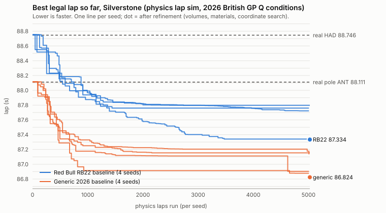

# CONCEPT campaign: can a legal 2026 car with the same engine beat the real Silverstone qualifying laps?

Version 1 · 2026-10-24 · branch `claude/beat-pole` · code `concept/campaign/`, guards in `concept/bench.js` and `concept/optimize.js`.
Every lap number below is labelled with its source. The source of every final number is **"physics lap sim · quasi-steady-state
point mass · Silverstone OSM centreline · calibrated to 2026 British GP qualifying"** (`concept/sim/`, docs/concept/SIM.md), run in
the 2026 British GP qualifying conditions (§3). The surrogate is used only to pre-screen candidates (§2); no reported number is a
surrogate value.

**The question.** Real 2026 Silverstone qualifying: pole ANT 88.111 s (Mercedes), HAD 88.746 s (Red Bull RB22, P5). Can a car that
obeys the FIA 2026 technical regulations (Section C, Issue 19, the issue in force at Silverstone) and keeps the baseline team's own
power unit (the Red Bull Ford DM01 for the RB22 baseline) lap faster on the physics lap sim?

## Answer (physics lap sim v2 · Silverstone · 2026 British GP qualifying conditions)

> **Current numbers (2026-10-24, re-run on physics lap sim v3 + the FIA geometry fixes, §4.0):** RB22 / DM01 best legal car
> **87.235 ± 0.154 s** (95 % 86.933–87.537) vs pole 88.111 (−0.876) and HAD 88.746 (−1.511) → P1 across the band; generic
> baseline **86.595 ± 0.189 s**. With the concept aero map's gains halved the RB22 car still laps 87.893 s (below pole). The v2
> numbers below are kept for comparison. The 129 mm throat of the v2 best is illegal under the enforced 75 mm roof; the v3 best uses 66.5 mm.


**The model predicts yes, inside the sim's own error band, and conditional on the concept design layer.** The best FIA-legal car
the campaign found on the Red Bull RB22 baseline, with the Red Bull Ford DM01 unchanged, laps **87.334 s ± 0.149 s (1σ; 95 %
band 87.043–87.625 s)** on the physics lap sim, against the real pole 88.111 s (**−0.777 s**) and HAD's real 88.746 s
(**−1.412 s**). That would have been **P1** of the 22 real 2026 qualifying laps, P1 across the whole 95 % band. The whole band is
below 88.111 s, so "faster than pole" is **outside the sim's measured uncertainty**.

What that band does and does not cover:

- **Covered:** the sim's held-out error on sector-time changes between cars (k = 0.166 × the design's sector changes = 0.147 s),
  the team-lap fit residuals (0.018 s RMS), the sim's numerical noise measured at this car (0.007 s). No number is a surrogate value.
- **Not covered, and larger than the band:** the concept aero map's relative coefficients (CONCEPT.md §5: component shares and
  slopes are guesses). If its gains are only half as large, the same car laps **88.023 s**: still 0.09 s under pole on the
  central value, but pole is then inside the 95 % band, so "beats pole" would no longer be resolved; "beats HAD" (−0.72 s) still would.
- **Open regulatory point:** the car runs `floor.throat_mm` 129 mm. `REG-C-FLOOR-ROOF` (C3.5.1(a), RV-FLOOR-BODY roof at Z = 75 mm)
  is not checkable yet because the parameter's definition conflicts with the roof (every value of its domain, the baseline's
  included, sits above it by its label; fix pending in `claude/sim-v3-fia`). Reverting the throat alone stalls the floor in the
  model, so its share cannot be isolated; the floor and diffuser group together is worth 0.43 s. Re-run after that merge (§3).
- **Same engine:** the DM01 is identical to the homologated PU in every field (ICE 398.6 kW, MGU-K 350 kW, ES 4 / 8.5 / 12.5 MJ,
  PU part masses and positions, transmission option a); energy within C5.2.9 / C5.2.10 (recharged 4.128 of 6.5 MJ, deployed 8.121 MJ).
- **Legal:** every checkable rule of `concept/regs.js` passes (46 checks, 0 FAIL); `REG-C-SUSP-WIDTH` is not enforced yet (every car,
  the real-team-fitted baselines included, fails it until the track-width fix lands) and `REG-C-FLOOR-ROOF` is not checkable (above).

**Sensitivity of the conclusion.** The same campaign on the generic 2026 baseline (the sim's car estimated on ANT's pole lap, its own
400 kW PU) reaches **86.824 s ± 0.159 s** (95 % 86.513–87.135 s, −1.287 s to pole): the same direction, a similar gain (−1.29 s vs
−1.42 s for the RB22) and the same design moves, so the conclusion does not hinge on the Red Bull anchor. On the previous sim
(v1, before the FIA-checklist rules) the RB22 campaign reached 87.102 s ± 0.208 s; the v2 sim and the X+Z front-wing envelope
cost 0.23 s and did not change the answer. Wind (2.6 m/s from any of 8 directions) moves the gain by −0.10 / +0.03 s.

**Run.** One command (§3), both baselines, 4 seeds × 5,000 physics laps + refinement: 44,810 physics laps, 824 s wall time on this
shared 4-CPU machine (510 s when it was less loaded). Deterministic: two runs of the same command gave identical numbers.

Never read this as "we beat F1": it is the physics lap sim's prediction for a concept car built from a parametric design layer
whose aero coefficients are not measured on any car.


## 1. Guards: same engine, legal car, permitted materials, energy limits

Every guard runs inside `concept/bench.js` `bench()`, so every caller (the campaign, `concept/optimize.js`, the Mubit designer
loop, the lab) gets it, and an illegal car never reaches the sim (no lap, no score). The optimiser refuses to run with the guards
off (`pu_guard: false` / `material_guard: false` throw). Tests: `test/concept-optimize-guards.test.js` (8),
`test/concept-campaign.test.js` (7).

| Guard | What it checks | Where | On failure |
|---|---|---|---|
| **FIA legality** | every checkable rule in `concept/regs.js` (`ALL_RULES`: Section C articles, the FIA-checklist combination rules incl. the X+Z front-wing envelope, rear wing ≥ 2 volumes, plank holes, sidepod inlet, the C15 material rules, the `PKG-PU-FIXED` PU lock on PU part masses and positions, and the concept model rules) | `regs.checkFacts` | illegal, no lap |
| **FIA checklist on the PhysicalCar** | `regs.checkPhysical(pc, { pu_ref })`: Section C PU / energy limits and the PU lock against the homologated PU. `REG-C-SUSP-WIDTH` is **not enforced yet** (`bench.PHYSICAL_SKIP`): every car fails it until the track-width fix (`claude/sim-v3-fia`) lands. `recharge_limit_mj` is not passed: `es_harvest_mj_per_lap` is the car's C5.2.10 cap (8.5 MJ); the session's 6.5 MJ applies to the energy a lap actually harvests (next-but-one row) | `bench()` | illegal, no lap |
| **Same engine** (`PU-HOMOLOGATED`, backstop) | the PhysicalCar's PU equals `bench.homologatedPU(team)` **exactly**: ICE kW (the anchor car's: 398.6 kW for the DM01 = the sim v2 RB22 fit; 400 kW generic), MGU-K 350 kW (C5.2.7), ES window 4 MJ (C5.2.9), recharge cap 8.5 MJ (C5.2.10), deploy 12.5 MJ; no other PU field (e.g. `superclip_kw`, which `regs.checkPhysical` does not look at but the sim reads); calibration `power_scale` = 1; PU part masses 118.5 / 12 / 20 / 35 / 5.7 kg and MGU-K transmission option a; no override on a PU part; the car anchored on its own team | `bench.checkPU` | illegal, no lap |
| **Materials** (`MAT-C15`, backstop) | a non-baseline material must be `permitted` (C15.2) in `concept/data/materials-2026.json`; the survival cell, nose and rear impact structure keep their baseline laminate (campaign rule, conservative: their lay-ups are homologated with the crash tests) | `bench.checkMaterials`; the campaign and `esProposer(λ, { materials: true })` only draw allowed ones | illegal, no lap |
| **Energy limits** (`ENERGY-LIMIT`) | on the sim's own report of every lap: recharge ≤ min(8.5 MJ, the session limit 6.5 MJ), deployment ≤ recharge + 4 MJ | `bench.checkEnergy` | illegal, not scored |

**Backstops.** The two campaign guards speak only when regs.js found nothing, so a car regs.js rejects carries exactly regs.js's
verdict (the FIA helper's test "bench legality = regs.check" holds), and a car regs.js lets through still cannot carry a changed PU
or a disallowed material. Gaps regs.js leaves today that the backstops close: an extra PU field the sim reads (`superclip_kw`); a
C15-permitted but non-CC-UHS laminate on the survival cell, e.g. `cfrp_t800s` (fibre Ftu 5880 MPa < the 6250 MPa C15.5.1(f)
threshold: `regs.check` passes it, REG-C-MAT-COMPONENT does not catch it; reported to the FIA-checklist owner).

Why a design cannot reach the PU: `concept/physical.js` builds `pu` from the anchor car (ICE), the part catalogue (MGU-K) and the
regulation constants (energy). A design moves the ICE only through the cooling derate, and a derating design fails the
`PKG-COOLING` model rule; a calibration `power_scale` is the only other route, and both PKG-PU-FIXED and the backstop reject it.
Fuel flow (C5.2.3-4) and the MGU-K taper (C5.2.8) are constants inside the sim, not PhysicalCar fields. The test runs 1,200 seeded
mutations and random walks (materials on, both baselines): every legal one carries the homologated PU exactly; the PU masses and the
transmission option never move.

**Proposer limits** (`optimize.proposerLimits`, `honourLimits`): the default ES proposer's values are clamped into the catalogue
domain narrowed by the rules a proposer can honour directly: front-wing chord ≤ `regs.fwProfilesChordLimit` (X+Z envelope for that
span, setting and volume count), rear wing ≥ 2 volumes, Straight Mode change ≥ 0, sidepod inlet ≤ 1600 cm². `ctx.params` carries the
narrowed bounds and `ctx.rules` the non-info combination rules. Legality stays the bench's call.

**Energy strategy.** The sim offers three deployment strategies, all inside the energy budget: `threshold` (the calibrated default),
`marginal` and `optimal` (SIM.md §3.4). The team cars, and so the real-lap comparison, are calibrated with `threshold` only.
Switching strategy alone moves the unmodified RB22 (sim v2) from 88.752 s to 88.292 s (`marginal`) or 87.776 s (`optimal`): a change
of calibration, not of car. The campaign scores with `threshold` and reports the other two only as best − baseline under the same
strategy (§4). `--strategy` exists on the CLI for studies.

**Bug reports (files read-only for this task).**
- `concept/materials.js` `problem(part, id)` checks only the material's form, not its FIA status, so `design.validate` accepts and
  `design.mutate(d, rng, step, { materials: true })` draws `cfrp_m60j` (forbidden, C15.2.3(b)(i)), `albemet_am162` (forbidden,
  C15.1.4) and `al_li_2195` (not_listed). Since the FIA-checklist merge `regs.check` rejects all three (REG-C-MAT-*), so no scored car
  can carry them; the mutation still wastes laps on them.
- `regs.checkPhysical(pc, { recharge_limit_mj: 6.5 })` rejects every car (REG-C-ES-RECHARGE: the PhysicalCar declares the 8.5 MJ
  C5.2.10 cap). The bench therefore checks the session limit on the lap's harvested energy instead.
- `concept/optimize.js` `hypothesize()` crashed on a material change (no `spec` for `material`); fixed here.

## 2. Method

**Search space** (`concept/campaign/space.js`): the 23 shape parameters of the part catalogue, each mapped to [0, 1] over the
catalogue's model domain **tightened by the single-number FIA limits** read from `regs.js` (wheelbase ≤ 3400 mm, front axle 0-150 mm,
cockpit 1830-2030 mm, bulkhead ≥ 360 mm, front span ≤ 1350 mm and ≤ 3 volumes, rear span ≤ 1150 mm, chord ≤ 465 mm, 2-3 volumes,
endplate ≤ 880 mm, floor body ≤ 1540 mm, sidepod inlet ≤ 1600 cm²). Tightening never makes a car legal; the full check still runs on
every candidate. One coupled limit is **repaired** when a vector is decoded: the front-wing chord is capped at the X+Z envelope for the
wing's own span, setting and volume count (`regs.fwProfilesChordLimit`, `regs.fwChordLimit`), rounded down to its 5 mm step: without
it ~1 sample in 40 near the baseline was legal (the RB22 baseline sits exactly on that envelope). The other coupled rules (Straight
Mode envelope, flap needs ≥ 2 volumes, mass and axle split, packaging, cooling, floor stall, plank) are handled by the fitness: an
illegal car ranks behind every legal one, by rules broken and relative excess.

**Per seed** (`runSeed`): CMA-ES (`cmaes.js`, Hansen's (μ/μ_w, λ) with rank-one and rank-μ updates, cyclic Jacobi eigendecomposition)
with restarts: from the baseline (σ 0.15, λ 16), wide from the baseline (σ 0.3, λ 32), local around the incumbent (σ 0.06), and from
a random legal point with λ doubling (IPOP-style); a restart ends after 25 generations without a 1 ms gain or when the search
distribution has collapsed (max std < 0.002). Each generation draws 4λ samples; the **surrogate** (`concept/surrogate`, physics
model) **pre-screens** them: the top ¾λ by surrogate lap plus a random ¼λ it never ranks are run on the **physics lap sim**, and
CMA-ES learns only from those physics laps. Outside the surrogate's training box (the best cars sit at its CLA and Straight Mode
balance edges) a candidate gets the batch's median rank, so the pre-screen is blind there rather than biased. Same seed, same run:
the rng is `design.seededRng(seed)` and every lap is a pure function of the design, so the worker count never changes a result
(tested with 0 and 2 workers).

**Refinement** of the best car over all seeds, all on the physics sim: (1) wing volume counts: a short CMA-ES (240 laps) for each of
the other front (1-3) / rear (2-3) combinations (a single-volume front wing loses its Straight Mode flap, C3.10.10(a)(i); the rear
needs ≥ 2 volumes, C3.11.7(b)); (2) material
swaps to every allowed material on every material part; (3) a coordinate pattern search, ± 1, 2, 4 … 32 quantisation steps on every
parameter; improving single moves are also combined cumulatively, best first. (2)-(3) repeat until neither improves or the budget
(3,000 laps) is spent.

**Final numbers** (`report`): the final design is benched again with the cache off, and `sim.simulateLap` is called directly on its
PhysicalCar; the two laps must be identical or the run fails. Sectors, trap and energy come from that lap; per-segment time from the
sim's own `contributions(best, baseline)` (sim v2: each corner zone, marker ±100 m, and the straights between; the segment deltas
add up to the lap delta); grid slot = 1 + the number of the 22 real 2026 qualifying laps strictly faster
(`EI.RACEPACE.silverstone.q`, best lap per driver). Where the time comes from by part group: each group reverted to the baseline on
its own, the rest kept, re-lapped on the physics sim.

**Uncertainty band** (`concept/campaign/uncertainty.js`), only from the sim's own measured errors (`concept/sim/fitted.js`):
(a) transfer error of a lap-time change: the sim's held-out sector times on the 10 team laps that entered the fit only through lap
time and trap; for each team and sector the predicted difference to the anchor team is compared with the real one, k = √(Σ(Δsim −
Δreal)² / ΣΔsim²) (sim v2: k = 0.166 against the RB22, 0.194 against the generic car), and a design that changes sector i by g_i
carries k·|g_i|, sectors in quadrature; (b) the RMS of the 11 team-lap fit residuals (sim v2: 0.018 s); (c) the sim's numerical
noise measured at the final car (21 laps over ±0.2 % CLA, RMS residual about a straight line; floor 0.005 s); (d) surrogate 0 (no
final number is a surrogate value). σ = √(a² + b² + c²); band ±1.96 σ. Reported beside it, not inside: the anchor's own fit
residual, the held-out sector bias (sim v2: −0.17 / +0.50 / −0.34 s, every team the same sign: the sim is S2-slow, S1/S3-fast) with
bias-corrected sectors, and the held-out speed-trace RMS (12.5 km/h). **Not covered**: the concept aero map's relative coefficients
(guesses, CONCEPT.md §5), part-mass estimates, and what the point-mass sim leaves out; §4 gives the what-if with the aero map's gains
halved.

**Parallelism.** `pool.js` runs `bench()` in worker threads. On this machine (4 logical CPUs, ~1.4 effective cores in this
container, shared with other jobs) more workers raise throughput only a little (measured: 58-82 physics laps/s with 1-4 workers);
the budget below is set for that.

## 3. Commands

```bash
npm ci
node --test test/concept-optimize-guards.test.js test/concept-campaign.test.js     # the guards and the campaign (~25 s)
node concept/campaign/run.js --seeds 1,2,3,4 --evals 5000 --baselines redbull,generic \
  --refine-evals 3000 --combo-evals 240 --out /tmp/purple-campaign \
  --svg docs/concept/campaign-convergence.svg --summary /tmp/purple-campaign/summary.md
```

**After a sim or regulation change** (e.g. `claude/sim-v3-fia`: track widths and the floor-throat roof): merge, then
1. if the track-width fix makes `regs.checkPhysical` pass `REG-C-SUSP-WIDTH` for the baselines, empty `PHYSICAL_SKIP` in
   `concept/bench.js` (the guard test fails on purpose to remind you); if `REG-C-FLOOR-ROOF` becomes a checked rule, nothing to do
   (the campaign reads `regs.ALL_RULES` and the box follows the catalogue domain);
2. retrain the physics surrogate if the sim changed (`node concept/surrogate/train.js --sim physics`; the campaign only uses it to
   pre-screen, a stale one costs laps, never accuracy);
3. `npm test`, then the campaign command above (~10-14 min here), and paste `/tmp/purple-campaign/summary.md` into §4 below.
The uncertainty band, the anchor laps and the held-out errors are read from the sim's fit at run time, so they follow the sim.

Writes `campaign.json` (everything: traces, kept candidates with their designs, legality reports, sensitivities), `summary.md` (the
tables in §4), `convergence.svg` and `best-<baseline>.json` (the final designs) to `--out`; refuses `data/` and `data-mock/`. No
network, no Mubit. Options: `--seeds`, `--evals` (physics laps per seed), `--lambda`, `--prescreen` (1 = no surrogate), `--workers`,
`--baselines`, `--refine-evals`, `--combo-evals`, `--strategy` (the sim's own; scoring with anything but `threshold` leaves the
calibration), `--no-sensitivity`, `--quiet`.

**Conditions** (`run.js qualiConditions`, from `concept/data/silverstone-2026-weekend.json` through the sim's
`loadWeekendConditions`): the 2026 British GP qualifying session, mid-range of the FIA weather chart: air 25.2 °C, track 40.4 °C
(chart 38.2-42.6 °C; the sim does not model track temperature), 1007.6 hPa, 48.2 % RH, dry, 6.5 MJ recharge limit. Wind: 0.3-4.9 m/s
with no published direction, so the scored laps use still air (as the sim's fit did) and §4 reports the wind sensitivity.

## 4. Results

### 4.0a Mubit-directed hybrid run, live trained (seed 41) — uncertainty band added 2026-10-24 12:45Z

`docs/concept/loop-runs/trained-hybrid-seed41/` (engine "auto": Mubit proposes → up to 600 legal physics laps of local search → kept only by the numbers → result in the next call; stopped by the owner): **88.763 → 87.282 s, 45 iterations, 35 live trained Mubit calls, 25,856 physics laps**. Re-scored with the campaign's band (`node concept/campaign/band-run.js trained-hybrid-seed41`, output `band.json`): **87.282 ± 0.148 s (95 % 86.992–87.572 s)**, Δ real pole (ANT 88.111) −0.829 s, Δ real HAD (88.746) −1.464 s; the whole 95 % band is faster than pole. Model prediction ± band (physics lap sim v3 · Silverstone · 2026 British GP qualifying conditions), not a claim about a real car.
**Who found the gains:** of the 17 kept changes, **7 came from Mubit's proposals and 10 from the engine's seeded fallback step** (used when the proposal was illegal ×14, a duplicate ×3, or the model was paused after failures ×10). Say "Mubit-directed loop", not "Mubit found 1.48 s". The CMA-ES best below (87.235 ± 0.154) is the optimiser's, not Mubit's.

### 4.0 Re-run on physics lap sim v3 + FIA geometry fixes (current numbers; 673.9 s wall time)

Source of every lap: **physics lap sim · quasi-steady-state point mass · Silverstone OSM centreline · calibrated to 2026 British GP qualifying** · Silverstone · 2026 British GP qualifying conditions · concept campaign v1 · CMA-ES + surrogate pre-screen · every number re-scored on the physics lap sim.

#### Baseline: Red Bull Racing RB22 · Red Bull Ford DM01 (concept shape on the inferred RB22 car)

| | Lap (s) | S1 / S2 / S3 (s) | Trap (km/h) | Δ pole 88.111 | Δ HAD 88.746 | Grid (real 2026 Q) |
|---|---|---|---|---|---|---|
| baseline | 88.763 | 28.616 / 35.865 / 24.282 | 305.2 | +0.652 | +0.017 | P6 |
| **campaign best** | **87.235** ± 0.154 (1σ) | 28.365 / 35.216 / 23.654 | 307.5 | -0.876 | -1.511 | P1 (95 %: P1–P1) |

95 % band 86.933–87.537 s. vs pole: faster than 88.111 s and the whole 95 % band (86.933–87.537 s) is below it: outside the model's uncertainty. vs HAD: faster than 88.746 s and the whole 95 % band (86.933–87.537 s) is below it: outside the model's uncertainty.

Uncertainty components (s): transfer 0.154 (k = 0.164 × sector changes -0.251 / -0.649 / -0.628), fit residual RMS 0.008, sim noise 0.005 (measured on the final car), surrogate 0. Sim's held-out trace RMS 10.2 km/h. Known bias: anchor residual +0.002 s (HAD); anchor-relative lap 87.218 s; held-out sector bias +0.172 / +0.015 / -0.192 s, bias-corrected sectors 28.193 / 35.201 / 23.846 s.

PU: Red Bull Ford DM01 — identical to the homologated PU (ice_kw 396.08, mguk_kw 350, es_deploy_mj_per_lap 12.5, es_harvest_mj_per_lap 8.5, es_soc_window_mj 4). Energy: deployed 7.633 MJ, recharged 3.657 MJ of 6.5 MJ (within C5.2.9 / C5.2.10).

| Part · parameter | From → to | At a limit |
|---|---|---|
| Ballast · x_frac | Ballast position along the wheelbase 0.05 × WB → 0.7 × WB |  |
| Rear wing assembly · sm_delta_deg | Straight-mode flap incidence reduction 15° → 29.5° |  |
| Front wing assembly · elements | Profile volumes 3 → 2 |  |
| Front wing assembly · sm_delta_deg | Straight-mode flap incidence reduction 4° → 10.5° |  |
| Survival cell · front_axle_offset_mm | Front axle behind cell front (XA→XF) 75 mm → 10 mm |  |
| Front wing assembly · aoa_deg | Wing setting (lab front_wing_deg units) 25° → 32.5° |  |
| Rear wing assembly · chord_mm | Chord (X extent) 420 mm → 355 mm |  |
| Rear wing assembly · aoa_deg | Wing setting (lab rear_wing_deg units) 20° → 26.5° |  |
| Sidepods · undercut_mm | Undercut depth 100 mm → 145 mm |  |
| Floor · throat_mm | Venturi throat roof height above Z=0 (≤ 75: RV-FLOOR-BODY roof, C3.5.1(a)) 60 mm → 66.5 mm |  |
| Floor · width_mm | Floor body width (2 × max |Y|) 1450 mm → 1540 mm | REG-C-FLOOR-WIDTH ≤ 1540 |
| Diffuser · expansion_deg | Diffuser expansion angle 14° → 16° |  |
| Rear wing assembly · span_mm | Span 1100 mm → 1150 mm | REG-C-RW-SPAN ≤ 1150 |
| Front wing assembly · span_mm | Span 1300 mm → 1350 mm | REG-C-FW-SPAN ≤ 1350 |
| Rear wing assembly · endplate_top_mm | Endplate top (Z) 860 mm → 880 mm | REG-C-RW-ENDPLATE ≤ 880 |
| Floor · ride_height_mm | Static ride height at the plank 35 mm → 31 mm |  |
| Sidepods · inlet_cm2 | Cooling inlet area (both sides) 650 cm² → 590 cm² |  |
| Survival cell · bulkhead_gap_mm | Cockpit rear to ICE face (XC→XPU) 380 mm → 360 mm | REG-C-BULKHEAD ≥ 360 |
| Survival cell · cockpit_len_mm | Cell front to cockpit rear (XA→XC) 1930 mm → 1910 mm |  |
| Front wing assembly · chord_mm | Mean chord (planform / span, X extent) 580 mm → 565 mm |  |
| Sidepods · material | material Carbon/epoxy prepreg, intermediate modulus (T800S class), quasi-isotropic → Carbon/epoxy prepreg, ultra-high strength (T1100G class), quasi-isotropic |  |

Where the time comes from (physics lap sim contributions(best, baseline): per corner zone (marker ±100 m) and straight, best − baseline; sum = lap delta -1.528 s):

| Segment | Δ time (s) |
|---|---|
| Abbey (T1) (corner, 340–523 m) | +0.006 (min 292.1 → 290.8 km/h) |
| Farm (T2) (corner, 523–705 m) | +0.016 (min 274.5 → 272.4 km/h) |
| T2 -> T3 (straight, 705–760 m) | +0.006 (min 266.6 → 264.4 km/h) |
| Village (T3) (corner, 760–945 m) | -0.163 (min 115.8 → 120.3 km/h) |
| The Loop (T4) (corner, 945–1125 m) | -0.115 (min 73.6 → 74.7 km/h) |
| Aintree (T5) (corner, 1125–1320 m) | -0.010 (min 180.1 → 183.2 km/h) |
| T5 -> T6 (straight, 1320–1850 m) | +0.001 (min 256 → 255.3 km/h) |
| Brooklands (T6) (corner, 1850–2050 m) | -0.215 (min 142.4 → 150.9 km/h) |
| T6 -> T7 (straight, 2050–2075 m) | -0.015 (min 160.8 → 170.8 km/h) |
| Luffield (T7) (corner, 2075–2275 m) | -0.197 (min 101.9 → 104.9 km/h) |
| T7 -> T8 (straight, 2275–2415 m) | -0.019 (min 192.6 → 197 km/h) |
| Woodcote (T8) (corner, 2415–2615 m) | -0.006 (min 255.2 → 255.9 km/h) |
| T8 -> T9 (straight, 2615–2940 m) | 0.000 (min 292.6 → 293.2 km/h) |
| Copse (T9) (corner, 2940–3140 m) | +0.005 (min 295.4 → 294.5 km/h) |
| T9 -> T10 (straight, 3140–3490 m) | +0.038 (min 295.5 → 294.5 km/h) |
| Maggotts (T10) (corner, 3490–3635 m) | +0.022 (min 300.8 → 296.9 km/h) |
| Maggotts (T11) (corner, 3635–3753 m) | +0.016 (min 289.1 → 286.1 km/h) |
| Becketts (T12) (corner, 3753–3898 m) | +0.017 (min 269.1 → 266.9 km/h) |
| Becketts (T13) (corner, 3898–4045 m) | -0.212 (min 197.6 → 221.7 km/h) |
| Chapel (T14) (corner, 4045–4220 m) | -0.079 (min 224.3 → 237.4 km/h) |
| T14 -> T15 (straight, 4220–4880 m) | -0.054 (min 268.6 → 272.5 km/h) |
| Stowe (T15) (corner, 4880–5080 m) | -0.258 (min 214.2 → 245.9 km/h) |
| T15 -> T16 (straight, 5080–5335 m) | -0.069 (min 231.8 → 250.4 km/h) |
| Vale (T16) (corner, 5335–5478 m) | -0.102 (min 113 → 117.2 km/h) |
| Club (T17) (corner, 5478–5595 m) | -0.113 (min 109.1 → 112.8 km/h) |
| Club (T18) (corner, 5595–5770 m) | -0.035 (min 166.9 → 173.5 km/h) |
| T18 -> T1 (straight, 5770–340 m) | +0.004 (min 246.5 → 246.9 km/h) |

| Seed | Best lap (s) | Physics laps | Surrogate-screened | Restarts | Runtime (s) |
|---|---|---|---|---|---|
| 1 | 87.320 | 5024 | 20096 | 2 | 38.6 |
| 2 | 87.242 | 5024 | 20096 | 2 | 65.8 |
| 3 | 87.288 | 5024 | 20096 | 2 | 53.8 |
| 4 | 87.583 | 5008 | 20032 | 2 | 78.5 |
| refine | 87.235 (from 87.242) | 2030 | — | — | 21.4 |

Sensitivity (physics sim): wind 2.6 m/s from 8 directions moves best − baseline between -1.707 and -1.407 s (still air -1.528). Strategy: threshold (calibrated) best 88.121 / baseline 89.704 (Δ -1.583); marginal best 87.585 / baseline 89.132 (Δ -1.547); optimal best 87.241 / baseline 88.816 (Δ -1.575). Aero-map gains halved: 87.893 s (Δ -0.870 vs baseline). Surrogate on the final car: 87.222 s (-0.013 vs physics, information only).

| Revert one group to the baseline (rest kept) | Lap (s) | Time the group is worth (s) |
|---|---|---|
| Straight Mode flap angles | 87.616 | -0.381 |
| front wing (span, chord, setting, volumes) | illegal (REG-C-FW-SM-ENVELOPE) | — |
| rear wing (span, chord, setting, volumes, endplate) | illegal (REG-C-MASS-FRONT) | — |
| floor and diffuser (width, throat, ride height, expansion) | illegal (REG-C-MASS-FRONT) | — |
| floor throat only (REG-C-FLOOR-ROOF not yet checkable) | illegal (PKG-FLOOR-STALL) | — |
| sidepods (inlet, undercut) | 87.511 | -0.276 |
| packaging (wheelbase, survival cell) | 87.396 | -0.161 |
| ballast (position, extra) | 87.318 | -0.083 |
| materials | 87.236 | -0.001 |

Legality: every check passes (47 checks pass, 7 info rules recorded). Runtime 262.8 s, 22111 physics laps.

#### Baseline: Baseline 2026-style concept car

| | Lap (s) | S1 / S2 / S3 (s) | Trap (km/h) | Δ pole 88.111 | Δ HAD 88.746 | Grid (real 2026 Q) |
|---|---|---|---|---|---|---|
| baseline | 88.107 | 28.367 / 35.674 / 24.066 | 310.2 | -0.004 | -0.639 | P1 |
| **campaign best** | **86.595** ± 0.189 (1σ) | 28.132 / 34.981 / 23.482 | 312.7 | -1.516 | -2.151 | P1 (95 %: P1–P1) |

95 % band 86.225–86.965 s. vs pole: faster than 88.111 s and the whole 95 % band (86.225–86.965 s) is below it: outside the model's uncertainty. vs HAD: faster than 88.746 s and the whole 95 % band (86.225–86.965 s) is below it: outside the model's uncertainty.

Uncertainty components (s): transfer 0.188 (k = 0.201 × sector changes -0.235 / -0.693 / -0.584), fit residual RMS 0.008, sim noise 0.005 (measured on the final car), surrogate 0. Sim's held-out trace RMS 10.2 km/h. Known bias: anchor residual -0.004 s (ANT); anchor-relative lap 86.599 s; held-out sector bias +0.172 / +0.015 / -0.192 s, bias-corrected sectors 27.960 / 34.966 / 23.674 s.

PU: generic 2026 PU (the physics sim's estimate) — identical to the homologated PU (ice_kw 400, mguk_kw 350, es_deploy_mj_per_lap 12.5, es_harvest_mj_per_lap 8.5, es_soc_window_mj 4). Energy: deployed 7.738 MJ, recharged 3.738 MJ of 6.5 MJ (within C5.2.9 / C5.2.10).

| Part · parameter | From → to | At a limit |
|---|---|---|
| Front wing assembly · sm_delta_deg | Straight-mode flap incidence reduction 4° → 19.5° |  |
| Ballast · x_frac | Ballast position along the wheelbase 0.05 × WB → 0.6 × WB |  |
| Floor · throat_mm | Venturi throat roof height above Z=0 (≤ 75: RV-FLOOR-BODY roof, C3.5.1(a)) 60 mm → 75 mm | model domain edge |
| Front wing assembly · elements | Profile volumes 3 → 2 |  |
| Rear wing assembly · elements | Profile volumes 2 → 3 | REG-C-RW-ELEMENTS ≤ 3; REG-C-ELEMENTS-MIN ≥ 2 |
| Rear wing assembly · sm_delta_deg | Straight-mode flap incidence reduction 15° → 24° |  |
| Front wing assembly · aoa_deg | Wing setting (lab front_wing_deg units) 25° → 33.5° |  |
| Survival cell · front_axle_offset_mm | Front axle behind cell front (XA→XF) 75 mm → 5 mm |  |
| Diffuser · expansion_deg | Diffuser expansion angle 14° → 17° |  |
| Sidepods · undercut_mm | Undercut depth 100 mm → 145 mm |  |
| Floor · width_mm | Floor body width (2 × max |Y|) 1450 mm → 1540 mm | REG-C-FLOOR-WIDTH ≤ 1540 |
| Floor · ride_height_mm | Static ride height at the plank 35 mm → 27 mm |  |
| Survival cell · cockpit_len_mm | Cell front to cockpit rear (XA→XC) 1930 mm → 1875 mm |  |
| Rear wing assembly · span_mm | Span 1100 mm → 1150 mm | REG-C-RW-SPAN ≤ 1150 |
| Front wing assembly · span_mm | Span 1300 mm → 1350 mm | REG-C-FW-SPAN ≤ 1350 |
| Rear wing assembly · endplate_top_mm | Endplate top (Z) 860 mm → 875 mm |  |
| Sidepods · inlet_cm2 | Cooling inlet area (both sides) 650 cm² → 590 cm² |  |
| Front wing assembly · chord_mm | Mean chord (planform / span, X extent) 580 mm → 545 mm |  |
| Rear wing assembly · aoa_deg | Wing setting (lab rear_wing_deg units) 20° → 21.5° |  |
| Survival cell · bulkhead_gap_mm | Cockpit rear to ICE face (XC→XPU) 380 mm → 375 mm |  |
| Rear wing assembly · chord_mm | Chord (X extent) 420 mm → 425 mm |  |
| Overall layout · wheelbase_mm | Wheelbase 3400 mm → 3395 mm |  |
| Rear wing assembly · material | material Carbon/epoxy prepreg, intermediate modulus (T800S class), quasi-isotropic → Carbon/epoxy prepreg, standard modulus (T700S class), quasi-isotropic |  |
| Sidepods · material | material Carbon/epoxy prepreg, intermediate modulus (T800S class), quasi-isotropic → Carbon/epoxy prepreg, ultra-high strength (T1100G class), quasi-isotropic |  |

Where the time comes from (physics lap sim contributions(best, baseline): per corner zone (marker ±100 m) and straight, best − baseline; sum = lap delta -1.512 s):

| Segment | Δ time (s) |
|---|---|
| Abbey (T1) (corner, 340–523 m) | +0.008 (min 296 → 294.4 km/h) |
| Farm (T2) (corner, 523–705 m) | +0.021 (min 279 → 276.2 km/h) |
| T2 -> T3 (straight, 705–760 m) | +0.008 (min 271.2 → 268.3 km/h) |
| Village (T3) (corner, 760–945 m) | -0.153 (min 115.8 → 120 km/h) |
| The Loop (T4) (corner, 945–1125 m) | -0.107 (min 73.6 → 74.6 km/h) |
| Aintree (T5) (corner, 1125–1320 m) | -0.007 (min 182.1 → 185.1 km/h) |
| T5 -> T6 (straight, 1320–1850 m) | -0.006 (min 258.3 → 257.5 km/h) |
| Brooklands (T6) (corner, 1850–2050 m) | -0.209 (min 142.5 → 150.4 km/h) |
| T6 -> T7 (straight, 2050–2075 m) | -0.016 (min 160.8 → 170 km/h) |
| Luffield (T7) (corner, 2075–2275 m) | -0.184 (min 101.9 → 104.7 km/h) |
| T7 -> T8 (straight, 2275–2415 m) | -0.017 (min 193 → 197.2 km/h) |
| Woodcote (T8) (corner, 2415–2615 m) | +0.006 (min 257.3 → 257.8 km/h) |
| T8 -> T9 (straight, 2615–2940 m) | +0.004 (min 295.8 → 294.4 km/h) |
| Copse (T9) (corner, 2940–3140 m) | +0.003 (min 298.7 → 298 km/h) |
| T9 -> T10 (straight, 3140–3490 m) | +0.029 (min 298.7 → 298 km/h) |
| Maggotts (T10) (corner, 3490–3635 m) | +0.012 (min 302.1 → 300.8 km/h) |
| Maggotts (T11) (corner, 3635–3753 m) | -0.003 (min 286.7 → 289.9 km/h) |
| Becketts (T12) (corner, 3753–3898 m) | -0.035 (min 265.5 → 270.7 km/h) |
| Becketts (T13) (corner, 3898–4045 m) | -0.206 (min 197.8 → 219.9 km/h) |
| Chapel (T14) (corner, 4045–4220 m) | -0.073 (min 225 → 238.7 km/h) |
| T14 -> T15 (straight, 4220–4880 m) | -0.058 (min 272.5 → 274.8 km/h) |
| Stowe (T15) (corner, 4880–5080 m) | -0.248 (min 214.4 → 243.4 km/h) |
| T15 -> T16 (straight, 5080–5335 m) | -0.051 (min 233.4 → 250.4 km/h) |
| Vale (T16) (corner, 5335–5478 m) | -0.090 (min 113.1 → 117 km/h) |
| Club (T17) (corner, 5478–5595 m) | -0.105 (min 109.1 → 112.6 km/h) |
| Club (T18) (corner, 5595–5770 m) | -0.033 (min 168.2 → 173 km/h) |
| T18 -> T1 (straight, 5770–340 m) | -0.003 (min 248.4 → 248.6 km/h) |

| Seed | Best lap (s) | Physics laps | Surrogate-screened | Restarts | Runtime (s) |
|---|---|---|---|---|---|
| 1 | 87.048 | 5008 | 20032 | 2 | 96.7 |
| 2 | 87.144 | 5008 | 20032 | 1 | 66.4 |
| 3 | 86.994 | 5008 | 20032 | 1 | 85.6 |
| 4 | 87.087 | 5008 | 20032 | 2 | 102.3 |
| refine | 86.595 (from 86.994) | 3062 | — | — | 57.8 |

Sensitivity (physics sim): wind 2.6 m/s from 8 directions moves best − baseline between -1.662 and -1.417 s (still air -1.512). Strategy: threshold (calibrated) best 87.500 / baseline 89.097 (Δ -1.597); marginal best 86.959 / baseline 88.507 (Δ -1.548); optimal best 86.551 / baseline 87.822 (Δ -1.271). Aero-map gains halved: 87.286 s (Δ -0.821 vs baseline). Surrogate on the final car: — s (— vs physics, information only).

| Revert one group to the baseline (rest kept) | Lap (s) | Time the group is worth (s) |
|---|---|---|
| Straight Mode flap angles | 86.862 | -0.267 |
| front wing (span, chord, setting, volumes) | illegal (REG-C-FW-SM-ENVELOPE) | — |
| rear wing (span, chord, setting, volumes, endplate) | 87.400 | -0.805 |
| floor and diffuser (width, throat, ride height, expansion) | 87.049 | -0.454 |
| floor throat only (REG-C-FLOOR-ROOF not yet checkable) | illegal (PKG-FLOOR-STALL) | — |
| sidepods (inlet, undercut) | 86.947 | -0.352 |
| packaging (wheelbase, survival cell) | 86.710 | -0.115 |
| ballast (position, extra) | 86.600 | -0.005 |
| materials | 86.638 | -0.043 |

Legality: every check passes (47 checks pass, 7 info rules recorded). Runtime 411 s, 23095 physics laps.


Source of every lap below: **physics lap sim v2** (concept/sim, label above) · Silverstone · 2026 British GP qualifying conditions (§3) · campaign `node concept/campaign/run.js --seeds 1,2,3,4 --evals 5000 --baselines redbull,generic --refine-evals 3000 --combo-evals 240` · wall time 824.2 s on this machine (4 logical CPUs, shared with other jobs; 4 worker threads). Generated by `summaryMarkdown()` (pasted unchanged); the convergence plot is `campaign-convergence.svg`.




### 4.1 Baseline: Red Bull Racing RB22 · Red Bull Ford DM01 (concept shape on the inferred RB22 car)

| | Lap (s) | S1 / S2 / S3 (s) | Trap (km/h) | Δ pole 88.111 | Δ HAD 88.746 | Grid (real 2026 Q) |
|---|---|---|---|---|---|---|
| baseline | 88.752 | 28.226 / 36.362 / 24.164 | 304.9 | +0.641 | +0.006 | P6 |
| **campaign best** | **87.334** ± 0.149 (1σ) | 28.029 / 35.698 / 23.607 | 301.7 | -0.777 | -1.412 | P1 (95 %: P1–P1) |

95 % band 87.043–87.625 s. vs pole: faster than 88.111 s and the whole 95 % band (87.043–87.625 s) is below it: outside the model's uncertainty. vs HAD: faster than 88.746 s and the whole 95 % band (87.043–87.625 s) is below it: outside the model's uncertainty.

Uncertainty components (s): transfer 0.147 (k = 0.166 × sector changes -0.197 / -0.664 / -0.557), fit residual RMS 0.018, sim noise 0.007 (measured on the final car), surrogate 0. Sim's held-out trace RMS 12.5 km/h. Known bias: anchor residual +0.001 s (HAD); anchor-relative lap 87.328 s; held-out sector bias -0.171 / +0.501 / -0.338 s, bias-corrected sectors 28.200 / 35.197 / 23.945 s.

PU: Red Bull Ford DM01 — identical to the homologated PU (ice_kw 398.6, mguk_kw 350, es_deploy_mj_per_lap 12.5, es_harvest_mj_per_lap 8.5, es_soc_window_mj 4). Energy: deployed 8.121 MJ, recharged 4.128 MJ of 6.5 MJ (within C5.2.9 / C5.2.10).

| Part · parameter | From → to | At a limit |
|---|---|---|
| Floor · throat_mm | Venturi throat height above Z=0 100 mm → 129 mm |  |
| Rear wing assembly · sm_delta_deg | Straight-mode flap incidence reduction 15° → 30° | model domain edge |
| Ballast · x_frac | Ballast position along the wheelbase 0.05 × WB → 0.4 × WB |  |
| Front wing assembly · elements | Profile volumes 3 → 2 |  |
| Front wing assembly · aoa_deg | Wing setting (lab front_wing_deg units) 25° → 32° |  |
| Sidepods · undercut_mm | Undercut depth 100 mm → 145 mm |  |
| Floor · ride_height_mm | Static ride height at the plank 35 mm → 25 mm |  |
| Floor · width_mm | Floor body width (2 × max |Y|) 1450 mm → 1540 mm | REG-C-FLOOR-WIDTH ≤ 1540 |
| Rear wing assembly · chord_mm | Chord (X extent) 420 mm → 465 mm | REG-C-RW-CHORD ≤ 465 |
| Front wing assembly · sm_delta_deg | Straight-mode flap incidence reduction 4° → 6.5° |  |
| Rear wing assembly · span_mm | Span 1100 mm → 1150 mm | REG-C-RW-SPAN ≤ 1150 |
| Diffuser · expansion_deg | Diffuser expansion angle 14° → 15.5° |  |
| Front wing assembly · span_mm | Span 1300 mm → 1350 mm | REG-C-FW-SPAN ≤ 1350 |
| Rear wing assembly · endplate_top_mm | Endplate top (Z) 860 mm → 880 mm | REG-C-RW-ENDPLATE ≤ 880 |
| Rear wing assembly · aoa_deg | Wing setting (lab rear_wing_deg units) 20° → 22.5° |  |
| Survival cell · front_axle_offset_mm | Front axle behind cell front (XA→XF) 75 mm → 55 mm |  |
| Sidepods · inlet_cm2 | Cooling inlet area (both sides) 650 cm² → 590 cm² |  |
| Survival cell · cockpit_len_mm | Cell front to cockpit rear (XA→XC) 1930 mm → 1955 mm |  |
| Survival cell · bulkhead_gap_mm | Cockpit rear to ICE face (XC→XPU) 380 mm → 360 mm | REG-C-BULKHEAD ≥ 360 |
| Front wing assembly · chord_mm | Mean chord (planform / span, X extent) 580 mm → 575 mm |  |
| Front suspension and steering · material | material Carbon/epoxy prepreg, intermediate modulus (T800S class), quasi-isotropic → Carbon/epoxy prepreg, ultra-high strength (T1100G class, CC-UHS-eligible), quasi-isotropic |  |

Where the time comes from (physics lap sim contributions(best, baseline): per corner zone (marker ±100 m) and straight, best − baseline; sum = lap delta -1.418 s):

| Segment | Δ time (s) |
|---|---|
| Abbey (T1) (corner, 340–523 m) | +0.021 (min 289.4 → 289 km/h) |
| Farm (T2) (corner, 523–705 m) | +0.025 (min 292.2 → 289 km/h) |
| T2 -> T3 (straight, 705–760 m) | +0.008 (min 292.4 → 289.2 km/h) |
| Village (T3) (corner, 760–945 m) | -0.162 (min 115.5 → 119.4 km/h) |
| The Loop (T4) (corner, 945–1125 m) | -0.129 (min 76.7 → 77.9 km/h) |
| Aintree (T5) (corner, 1125–1320 m) | -0.045 (min 177.7 → 182.5 km/h) |
| T5 -> T6 (straight, 1320–1850 m) | +0.057 (min 272.6 → 273.6 km/h) |
| Brooklands (T6) (corner, 1850–2050 m) | -0.215 (min 142.2 → 149.1 km/h) |
| T6 -> T7 (straight, 2050–2075 m) | -0.025 (min 158.6 → 166.7 km/h) |
| Luffield (T7) (corner, 2075–2275 m) | -0.182 (min 102.1 → 104.9 km/h) |
| T7 -> T8 (straight, 2275–2415 m) | -0.039 (min 190.1 → 197.9 km/h) |
| Woodcote (T8) (corner, 2415–2615 m) | +0.009 (min 267.6 → 268.7 km/h) |
| T8 -> T9 (straight, 2615–2940 m) | +0.043 (min 292.8 → 289.9 km/h) |
| Copse (T9) (corner, 2940–3140 m) | +0.022 (min 288.5 → 288.8 km/h) |
| T9 -> T10 (straight, 3140–3490 m) | +0.048 (min 292.3 → 289.2 km/h) |
| Maggotts (T10) (corner, 3490–3635 m) | +0.020 (min 292.4 → 289.2 km/h) |
| Maggotts (T11) (corner, 3635–3753 m) | +0.016 (min 292.2 → 289 km/h) |
| Becketts (T12) (corner, 3753–3898 m) | -0.072 (min 263.6 → 286.5 km/h) |
| Becketts (T13) (corner, 3898–4045 m) | -0.193 (min 190.8 → 205.6 km/h) |
| Chapel (T14) (corner, 4045–4220 m) | -0.097 (min 213.7 → 231.3 km/h) |
| T14 -> T15 (straight, 4220–4880 m) | +0.068 (min 282.2 → 287.4 km/h) |
| Stowe (T15) (corner, 4880–5080 m) | -0.219 (min 196.3 → 212.1 km/h) |
| T15 -> T16 (straight, 5080–5335 m) | -0.077 (min 220.8 → 235.8 km/h) |
| Vale (T16) (corner, 5335–5478 m) | -0.113 (min 120.2 → 124.5 km/h) |
| Club (T17) (corner, 5478–5595 m) | -0.108 (min 112.2 → 115.7 km/h) |
| Club (T18) (corner, 5595–5770 m) | -0.102 (min 161.4 → 168.2 km/h) |
| T18 -> T1 (straight, 5770–340 m) | +0.024 (min 257 → 261.2 km/h) |

| Seed | Best lap (s) | Physics laps | Surrogate-screened | Restarts | Runtime (s) |
|---|---|---|---|---|---|
| 1 | 87.797 | 5024 | 20096 | 2 | 63.9 |
| 2 | 87.723 | 5008 | 20032 | 1 | 88.1 |
| 3 | 87.760 | 5008 | 20032 | 2 | 87.2 |
| 4 | 87.341 | 5024 | 20096 | 2 | 78.3 |
| refine | 87.334 (from 87.341) | 2026 | — | — | 16.4 |

Sensitivity (physics sim): wind 2.6 m/s from 8 directions moves best − baseline between -1.518 and -1.384 s (still air -1.418). Strategy: threshold (calibrated) best 87.334 / baseline 88.752 (Δ -1.418); marginal best 86.716 / baseline 88.292 (Δ -1.576); optimal best 86.097 / baseline 87.776 (Δ -1.679). Aero-map gains halved: 88.023 s (Δ -0.729 vs baseline). Surrogate on the final car: — s (— vs physics, information only).

| Revert one group to the baseline (rest kept) | Lap (s) | Time the group is worth (s) |
|---|---|---|
| Straight Mode flap angles | 87.564 | -0.230 |
| front wing (span, chord, setting, volumes) | illegal (REG-C-FW-SM-ENVELOPE) | — |
| rear wing (span, chord, setting, volumes, endplate) | 88.426 | -1.092 |
| floor and diffuser (width, throat, ride height, expansion) | 87.760 | -0.426 |
| floor throat only (REG-C-FLOOR-ROOF not yet checkable) | illegal (PKG-FLOOR-STALL) | — |
| sidepods (inlet, undercut) | 87.607 | -0.273 |
| packaging (wheelbase, survival cell) | 87.484 | -0.150 |
| ballast (position, extra) | 87.356 | -0.022 |
| materials | 87.340 | -0.006 |

Legality: every check passes (46 checks pass, 7 info rules recorded). Runtime 337.9 s, 22091 physics laps.

### 4.2 Baseline: Baseline 2026-style concept car

| | Lap (s) | S1 / S2 / S3 (s) | Trap (km/h) | Δ pole 88.111 | Δ HAD 88.746 | Grid (real 2026 Q) |
|---|---|---|---|---|---|---|
| baseline | 88.115 | 28.017 / 36.126 / 23.971 | 314.7 | +0.004 | -0.631 | P2 |
| **campaign best** | **86.824** ± 0.159 (1σ) | 27.847 / 35.541 / 23.437 | 312 | -1.287 | -1.922 | P1 (95 %: P1–P1) |

95 % band 86.513–87.135 s. vs pole: faster than 88.111 s and the whole 95 % band (86.513–87.135 s) is below it: outside the model's uncertainty. vs HAD: faster than 88.746 s and the whole 95 % band (86.513–87.135 s) is below it: outside the model's uncertainty.

Uncertainty components (s): transfer 0.157 (k = 0.194 × sector changes -0.170 / -0.585 / -0.534), fit residual RMS 0.018, sim noise 0.005 (measured on the final car), surrogate 0. Sim's held-out trace RMS 12.5 km/h. Known bias: anchor residual +0.004 s (ANT); anchor-relative lap 86.820 s; held-out sector bias -0.171 / +0.501 / -0.338 s, bias-corrected sectors 28.018 / 35.040 / 23.775 s.

PU: generic 2026 PU (the physics sim's estimate) — identical to the homologated PU (ice_kw 400, mguk_kw 350, es_deploy_mj_per_lap 12.5, es_harvest_mj_per_lap 8.5, es_soc_window_mj 4). Energy: deployed 7.018 MJ, recharged 3.019 MJ of 6.5 MJ (within C5.2.9 / C5.2.10).

| Part · parameter | From → to | At a limit |
|---|---|---|
| Floor · throat_mm | Venturi throat height above Z=0 100 mm → 130 mm | model domain edge |
| Rear wing assembly · sm_delta_deg | Straight-mode flap incidence reduction 15° → 30° | model domain edge |
| Rear wing assembly · chord_mm | Chord (X extent) 420 mm → 300 mm | REG-C-RW-CHORD ≤ 465 |
| Rear wing assembly · aoa_deg | Wing setting (lab rear_wing_deg units) 20° → 31.5° |  |
| Ballast · x_frac | Ballast position along the wheelbase 0.05 × WB → 0.41 × WB |  |
| Front wing assembly · elements | Profile volumes 3 → 2 |  |
| Survival cell · front_axle_offset_mm | Front axle behind cell front (XA→XF) 75 mm → 150 mm | REG-C-FRONT-AXLE ≤ 150 |
| Survival cell · cockpit_len_mm | Cell front to cockpit rear (XA→XC) 1930 mm → 2030 mm | REG-C-COCKPIT ≥ 1830; REG-C-COCKPIT ≤ 2030 |
| Front wing assembly · aoa_deg | Wing setting (lab front_wing_deg units) 25° → 32° |  |
| Sidepods · undercut_mm | Undercut depth 100 mm → 145 mm |  |
| Floor · ride_height_mm | Static ride height at the plank 35 mm → 25 mm |  |
| Floor · width_mm | Floor body width (2 × max |Y|) 1450 mm → 1540 mm | REG-C-FLOOR-WIDTH ≤ 1540 |
| Diffuser · expansion_deg | Diffuser expansion angle 14° → 16° |  |
| Rear wing assembly · span_mm | Span 1100 mm → 1150 mm | REG-C-RW-SPAN ≤ 1150 |
| Front wing assembly · span_mm | Span 1300 mm → 1350 mm | REG-C-FW-SPAN ≤ 1350 |
| Front wing assembly · sm_delta_deg | Straight-mode flap incidence reduction 4° → 6° |  |
| Rear wing assembly · endplate_top_mm | Endplate top (Z) 860 mm → 880 mm | REG-C-RW-ENDPLATE ≤ 880 |
| Sidepods · inlet_cm2 | Cooling inlet area (both sides) 650 cm² → 590 cm² |  |
| Survival cell · bulkhead_gap_mm | Cockpit rear to ICE face (XC→XPU) 380 mm → 360 mm | REG-C-BULKHEAD ≥ 360 |
| Front wing assembly · chord_mm | Mean chord (planform / span, X extent) 580 mm → 575 mm |  |
| Diffuser · material | material Carbon/epoxy prepreg, intermediate modulus (T800S class), quasi-isotropic → Carbon/epoxy prepreg, standard modulus (T700S class), quasi-isotropic |  |

Where the time comes from (physics lap sim contributions(best, baseline): per corner zone (marker ±100 m) and straight, best − baseline; sum = lap delta -1.291 s):

| Segment | Δ time (s) |
|---|---|
| Abbey (T1) (corner, 340–523 m) | +0.020 (min 292.7 → 290.3 km/h) |
| Farm (T2) (corner, 523–705 m) | +0.026 (min 293.7 → 290.4 km/h) |
| T2 -> T3 (straight, 705–760 m) | +0.009 (min 293.9 → 290.6 km/h) |
| Village (T3) (corner, 760–945 m) | -0.151 (min 115.4 → 119 km/h) |
| The Loop (T4) (corner, 945–1125 m) | -0.109 (min 76.6 → 77.8 km/h) |
| Aintree (T5) (corner, 1125–1320 m) | -0.034 (min 177.6 → 182.5 km/h) |
| T5 -> T6 (straight, 1320–1850 m) | +0.044 (min 273.8 → 274.5 km/h) |
| Brooklands (T6) (corner, 1850–2050 m) | -0.207 (min 142 → 148.5 km/h) |
| T6 -> T7 (straight, 2050–2075 m) | -0.023 (min 158.2 → 165.7 km/h) |
| Luffield (T7) (corner, 2075–2275 m) | -0.161 (min 102.1 → 104.6 km/h) |
| T7 -> T8 (straight, 2275–2415 m) | -0.033 (min 189.7 → 196.3 km/h) |
| Woodcote (T8) (corner, 2415–2615 m) | +0.009 (min 268.5 → 270.4 km/h) |
| T8 -> T9 (straight, 2615–2940 m) | +0.036 (min 295.9 → 293.2 km/h) |
| Copse (T9) (corner, 2940–3140 m) | +0.017 (min 289.1 → 290.2 km/h) |
| T9 -> T10 (straight, 3140–3490 m) | +0.063 (min 293.9 → 290.5 km/h) |
| Maggotts (T10) (corner, 3490–3635 m) | +0.035 (min 297.5 → 291.9 km/h) |
| Maggotts (T11) (corner, 3635–3753 m) | +0.021 (min 293.7 → 290.3 km/h) |
| Becketts (T12) (corner, 3753–3898 m) | -0.078 (min 262.6 → 286.5 km/h) |
| Becketts (T13) (corner, 3898–4045 m) | -0.174 (min 190.3 → 204.2 km/h) |
| Chapel (T14) (corner, 4045–4220 m) | -0.086 (min 213.3 → 229 km/h) |
| T14 -> T15 (straight, 4220–4880 m) | +0.052 (min 283.6 → 288.2 km/h) |
| Stowe (T15) (corner, 4880–5080 m) | -0.216 (min 195.8 → 210.5 km/h) |
| T15 -> T16 (straight, 5080–5335 m) | -0.074 (min 220.4 → 236.1 km/h) |
| Vale (T16) (corner, 5335–5478 m) | -0.108 (min 120 → 124.1 km/h) |
| Club (T17) (corner, 5478–5595 m) | -0.098 (min 112.1 → 115.4 km/h) |
| Club (T18) (corner, 5595–5770 m) | -0.086 (min 162.6 → 168.2 km/h) |
| T18 -> T1 (straight, 5770–340 m) | +0.016 (min 257.7 → 261.5 km/h) |

| Seed | Best lap (s) | Physics laps | Surrogate-screened | Restarts | Runtime (s) |
|---|---|---|---|---|---|
| 1 | 87.134 | 5008 | 20032 | 2 | 101.1 |
| 2 | 86.904 | 5008 | 20032 | 2 | 143.5 |
| 3 | 87.154 | 5024 | 20096 | 2 | 105.6 |
| 4 | 86.878 | 5008 | 20032 | 2 | 92.9 |
| refine | 86.824 (from 86.878) | 2670 | — | — | 41.3 |

Sensitivity (physics sim): wind 2.6 m/s from 8 directions moves best − baseline between -1.403 and -1.210 s (still air -1.291). Strategy: threshold (calibrated) best 86.824 / baseline 88.115 (Δ -1.291); marginal best 86.158 / baseline 87.530 (Δ -1.372); optimal best 85.579 / baseline 87.142 (Δ -1.563). Aero-map gains halved: 87.411 s (Δ -0.704 vs baseline). Surrogate on the final car: — s (— vs physics, information only).

| Revert one group to the baseline (rest kept) | Lap (s) | Time the group is worth (s) |
|---|---|---|
| Straight Mode flap angles | 87.103 | -0.279 |
| front wing (span, chord, setting, volumes) | illegal (REG-C-FW-SM-ENVELOPE) | — |
| rear wing (span, chord, setting, volumes, endplate) | 87.720 | -0.896 |
| floor and diffuser (width, throat, ride height, expansion) | 87.258 | -0.434 |
| floor throat only (REG-C-FLOOR-ROOF not yet checkable) | illegal (PKG-FLOOR-STALL) | — |
| sidepods (inlet, undercut) | 87.083 | -0.259 |
| packaging (wheelbase, survival cell) | 86.845 | -0.021 |
| ballast (position, extra) | 86.849 | -0.025 |
| materials | 86.844 | -0.020 |

Legality: every check passes (46 checks pass, 7 info rules recorded). Runtime 486.1 s, 22719 physics laps.

### 4.3 Same engine and legality of the RB22 campaign best

| Field | Homologated Red Bull Ford DM01 | Campaign best | Same |
|---|---|---|---|
| `ice_kw` | 398.6 | 398.6 | yes |
| `mguk_kw` | 350 | 350 | yes |
| `es_deploy_mj_per_lap` | 12.5 | 12.5 | yes |
| `es_harvest_mj_per_lap` | 8.5 | 8.5 | yes |
| `es_soc_window_mj` | 4 | 4 | yes |
| PU part masses (kg) | ice 118.5, turbo 12, mguk 20, es 35, electronics 5.7 | unchanged (PKG-PU-FIXED pass, guard violations 0) | yes |
| MGU-K transmission option | a | a | yes |

Full legality report of the RB22 campaign best (every rule `concept/regs.js` knows, plus the campaign guards; FIA 2026 Section C Issue 19):

| Rule | Article | Limit | Car | Status |
|---|---|---|---|---|
| REG-C-WIDTH | C2.3.1 | ≤ 950 mm from Y=0 | 770 | pass |
| REG-C-WB | C2.3.3 | ≤ 3400 mm | 3400 | pass |
| REG-C-FRONT-AXLE | C2.3.4 | 0–150 mm behind XA=0 | 55 | pass |
| REG-C-COCKPIT | C2.3.5 | 1830–2030 mm | 1955 | pass |
| REG-C-BULKHEAD | C2.3.6 | ≥ 360 mm | 360 | pass |
| REG-C-FLOOR-WIDTH | C3.5.1(a), App. C2 §4.9 | ≤ 1540 mm (2 × \|Y\|) | 1540 | pass |
| REG-C-FW-ELEMENTS | C3.10.1(b) | ≤ 3 volumes | 2 | pass |
| REG-C-FW-SPAN | C3.10.1(a), App. C2 §22.1 | ≤ 1350 mm | 1350 | pass |
| REG-C-FW-CHORD | C3.10.1(a), App. C2 §21.1, §22.1-22.4 | ≤ 593.53 mm (at this span) | 575 | pass |
| REG-C-FW-SM-ENVELOPE | C3.10.10(s)(i), (u) | ≤ 593.53 mm (at this span) | 593.489 | pass |
| REG-C-RW-ELEMENTS | C3.11.1(b) | ≤ 3 volumes | 2 | pass |
| REG-C-RW-SPAN | C3.11.1(a), App. C2 §30.1 | ≤ 1150 mm | 1150 | pass |
| REG-C-RW-CHORD | C3.11.1(a), App. C2 §30.1-30.2 | ≤ 465 mm | 465 | pass |
| REG-C-RW-ENDPLATE | C3.11.2(a), App. C2 §31.1 | ≤ 880 mm above Z=0 | 880 | pass |
| REG-C-FW-FLAP | C3.10.10(a)(i) | ≥ 2 volumes | 2 volumes, flap 6.5° | pass |
| REG-C-RW-FLAP | C3.11.6(a)(i) | ≥ 2 volumes | 2 volumes, flap 30° | pass |
| REG-C-RW-FLAP-SPAN | C3.11.6(a)(ii)-(iii) | 535 mm (\|Y\|) | — | info (recorded; not a shape/mass check) |
| REG-C-AERO-MODES | C3.10.10(n)-(o), C3.11.6(c)-(d) | 400 ms transition | — | info (recorded; not a shape/mass check) |
| REG-C-PLANK | C3.6.1(d) | ≤ 2 mm wear | 1.75 | pass |
| REG-C-MASS-MIN | C4.1 | ≥ 770 kg (726 + NTM 44, estimate) | 770 | pass |
| REG-C-MASS-FRONT | C4.2(i) | ≥ 338.8 kg | 339.25 | pass |
| REG-C-MASS-REAR | C4.2(ii) | ≥ 415.8 kg | 430.75 | pass |
| REG-C-DRIVER-MASS | C4.5.2 | ≥ 82 kg | 82 | pass |
| REG-C-PU-MASS | C5.5.2 | ≥ 185 kg | 191.2 | pass |
| REG-C-ICE-MASS | C5.5.1 | ≥ 130 kg (by MGU-K transmission option) | 130.5 | pass |
| REG-C-TC-MASS | C5.3.4 | ≥ 12 kg | 12 | pass |
| REG-C-MGUK-MASS | C5.18.7 | ≥ 16 kg (by MGU-K transmission option) | 20 | pass |
| REG-C-ES-MASS | C5.17.9 | ≥ 35 kg | 35 | pass |
| REG-C-PU-COG | C5.5.3 | ≥ 200 mm (Z) | 248 | pass |
| REG-C-DRIVELINE-MASS | C9.5.2 | ≥ 22 kg | 48.6 | pass |
| REG-C-RIMS | C10.7.2 | 463 mm rim diameter | — | info (recorded; not a shape/mass check) |
| REG-C-ERS-K | C5.2.7 | 350 kW | 350 | pass (regs.checkPhysical on the PhysicalCar; the lap's energy: ENERGY-LIMIT) |
| REG-C-ERS-K-TAPER | C5.2.8(i) | 345 km/h (ERS-K propulsion power 0 at and above) | — | info (recorded; not a shape/mass check) |
| REG-C-ES-SOC | C5.2.9 | 4 MJ | 4 | pass (regs.checkPhysical on the PhysicalCar; the lap's energy: ENERGY-LIMIT) |
| REG-C-ES-RECHARGE | C5.2.10 | 8.5 MJ per lap | 8.5 (cap; the lap's own: ENERGY-LIMIT) | pass (regs.checkPhysical on the PhysicalCar; the lap's energy: ENERGY-LIMIT) |
| REG-C-FUEL-FLOW | C5.2.3 | 3000 MJ/h | ICE 398.6 kW (fuel-flow curve inside the sim) | pass (regs.checkPhysical on the PhysicalCar; the lap's energy: ENERGY-LIMIT) |
| PKG-WB | concept packaging model v0 | ≥ 3400 mm | 3400 | pass |
| PKG-COOLING | concept thermal model v0 | ≥ 1.05 × the PU's cooling need | 1.05 | pass |
| PKG-FLOOR-STALL | concept floor model v0 | ≥ 2 mm above the stall gap | 2.104 | pass |
| REG-C-FW-PROFILES-Z | C3.10.1(a), App. C2 §22.1-22.4 | ≤ 580 mm mean chord (at the baseline 1300 mm span, 25°, 3 volumes; depends on span, setting and volume count) | 575 mm (limit here 576.097) | pass |
| REG-C-RW-PROFILES-Z | C3.11.1(a), (d), App. C2 §30.1-30.2 | 465 mm chord (at the baseline 1100 mm span, 20°, 2 volumes; depends on span, setting and volume count) | — | info (recorded; not a shape/mass check) |
| REG-C-SM-DIRECTION | C3.10.10(n)(ii), C3.11.6(c)(ii) | ≥ 0 ° (straight-mode change) | front 6.5°, rear 30° | pass |
| REG-C-ELEMENTS-MIN | C3.10.1(b), (d); C3.11.1(b), C3.11.7(b) | ≥ 1 volumes (integer; front ≥ 1, rear ≥ 2) | front 2, rear 2 | pass |
| REG-C-PLANK-HOLES | C3.6.1(c) | ≥ 970 mm (XR − XPU) | 1140 | pass |
| REG-C-SIDEPOD-INLET | C3.16.9 | ≤ 1600 cm² (both sides) | 590 | pass |
| REG-C-SUSP-WIDTH | C10.10.1, C2.1.3(a), C10.7.2(a) | ≤ 603 mm \|Y\| of the wheel coordinate origin (front 603, rear 525) | — | not enforced yet (model input pending) |
| REG-C-FLOOR-ROOF | C3.5.1(a), App. C2 §4.5, §4.11 | 75 mm (Z) between XF=1775 and XR=−600 | floor.throat_mm 129 ("above Z=0" by its label) | NOT CHECKED: parameter definition conflict (FIA_CHECKLIST.md); fix pending in claude/sim-v3-fia |
| REG-C-HEAT-HAZARD | C4.1, C4.6(a) | 5 kg | — | info (recorded; not a shape/mass check) |
| REG-C-BALLAST | C4.3.1-C4.3.3 | — | — | info (recorded; not a shape/mass check) |
| PKG-PU-FIXED | concept PU lock (owner constraint: the baseline team's homologated PU, C5.5.7, App. C4) | required | PU rows and option as the baseline | pass |
| PKG-PART-MASS | concept mass model v1 | ≥ 0 kg per part | — | pass |
| REG-C-MAT-SPECIFIC-MODULUS | C15.1.4 | ≤ 40 GPa/(g/cm³), metallic materials | — | pass |
| REG-C-MAT-PERMITTED | C15.1.1, C15.1.3, C15.2, C15.4 | required | front_suspension: cfrp_t1100g | pass |
| REG-C-MAT-PROHIBITED | C15.3.1-C15.3.2 | required | — | pass |
| REG-C-MAT-PU | C15.6.1 | required | — | pass |
| REG-C-MAT-COMPONENT | C10.7.1, C7.4.1(a)-(b), C11.2.2, C15.5.3, C3.19.1, C12.4.2, C3.6.2(a), C3.6.3(d), C15.3.3, C15.3.4, C9.6.4, C9.10 | required | — | pass |
| REG-C-MAT-DENSITY | C4.3.2(d), C5.5.8(d) | ≥ 7500 kg/m³ | — | pass |
| PU-HOMOLOGATED | C5 · the baseline team's homologated power unit, unchanged (campaign rule: same engine) | identical | ICE 398.6 kW, MGU-K 350 kW, ES 4 / 8.5 MJ | pass |
| MAT-C15 | C15 (materials data fia.status; homologated safety structures fixed) | permitted | front_suspension: cfrp_t1100g | pass |


### 4.4 Previous sim (v1, before the sim-v2 and FIA-checklist merge), same campaign settings

| Baseline | Baseline lap | Best lap ± 1σ | Δ pole | Grid |
|---|---|---|---|---|
| RB22 (sim v1) | 88.749 | 87.102 ± 0.208 | −1.009 | P1 |
| generic (sim v1) | 88.312 | 86.757 ± 0.231 | −1.354 | P1 |

The v1 best ran a three-volume front wing at 35° and 530 mm, which the FIA-checklist X+Z envelope (REG-C-FW-PROFILES-Z) now rejects.

## 5. Limits (read before quoting a number)

1. **The design layer sets the gain.** The physics sim turns a PhysicalCar into a lap; the PhysicalCar's change from the RB22 comes
   from the concept aero map and part-mass estimates (CONCEPT.md §2, §5), which are not measured on any car. The rear wing alone is
   worth 1.09 s here, and its span, chord and endplate all sit on their FIA limits; the Straight Mode flaps sit on the model domain's
   edge (rear 30°), which is a modelling choice, not a rule. The halved-gains what-if (88.023 s) is the honest lower bound on how much
   of the answer rests on that map.
2. **Optimiser convergence.** Four seeds disagree by 0.46 s on the RB22 (87.34-87.80 s): three stayed in a three-volume front-wing
   basin, one found the two-volume one; the refinement tried every other volume combination from the best car and none beat it.
   A faster legal car in this model may exist, so 87.334 s is what the search found, not a proven optimum; more search can only
   strengthen "beats pole" in the model.
3. **The sim's own limits** (SIM.md §7): point mass, one racing line for every car, mid-speed corners 15-25 km/h slow on held-out
   laps (sector bias −0.17 / +0.50 / −0.34 s), held-out speed-trace RMS 12.5 km/h, track temperature not modelled, energy strategy
   behavioural (`threshold`). Under the sim's other strategies the gain over the baseline grows (−1.58 s `marginal`, −1.68 s
   `optimal`), but those are not calibrated to the real laps.
4. **Rules not yet enforced:** `REG-C-SUSP-WIDTH` (track widths; every car fails today) and `REG-C-FLOOR-ROOF` (floor-throat
   definition). Both are being fixed in `claude/sim-v3-fia`; the campaign must be re-run after that merge (§3).
5. **Real-lap comparison.** The grid slot inserts one simulated lap among the 22 real best laps; the real laps include drivers,
   tyres and track evolution the model does not have. The RB22 baseline itself laps 88.752 s against HAD's real 88.746 s (fit).
6. **Mass and materials:** the car stays at the 770 kg qualifying minimum (726 kg + an estimated 44 kg Nominal Tyre Mass) with
   ballast; material swaps are worth ≤ 0.02 s here, and their FIA status is the materials file's reading (`verified: false`).
