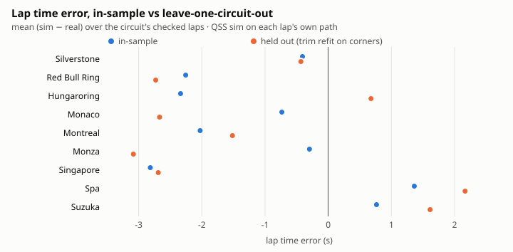
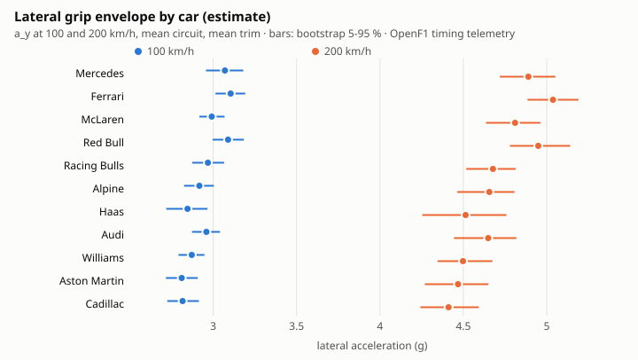
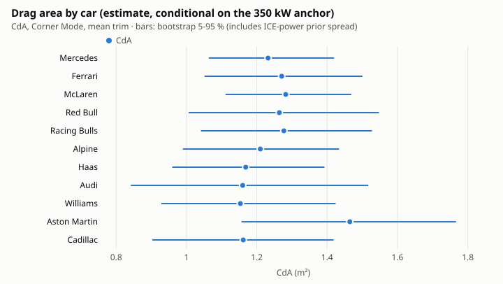

# Joint identification of the 11 2026 cars over 9 circuits

Every number here is an **estimate from public timing telemetry (OpenF1)**: speed, throttle, brake, gear, rpm and x/y on a 5 m grid, one qualifying lap per driver per circuit. None of it is team data. The parameters are **effective values of a point-mass model**, so read them as a way to compare the cars with each other, not as physical measurements (see "Scale").

This extends the single-lap inverse dynamics in `concept/tools/derive-car.js` ([REDBULL-DERIVED.md](REDBULL-DERIVED.md)) to all 11 cars and 9 circuits at once.

- **Per car**: tyre friction, aero, ICE power and mass, shared by every circuit.
- **Per car per circuit**: wing level, as a downforce trim and a drag trim.
- **Per circuit**: a grip factor.
- **Priors**: the sourced bands in `concept/data/priors-2026.json` act as regularisation.
- **Uncertainty**: mean ± std from a bootstrap over laps and segments.
- **Checks**: leave-one-circuit-out, plus a lap simulation on each lap's own path.

| | |
|---|---|
| Reproduce | `node concept/identify/identify.js --write` (seed 2026, 200 bootstrap replicates, 110 s on one core). `--boot N`, `--seed S`, `--circuits a,b`, `--no-loco`, `--no-sim-compat`, `--md` |
| Output | `concept/data/cars-2026-identified.json`: per-car parameters ± std, per-circuit trims, provenance, fit quality, leave-one-circuit-out, concept/sim check |
| Code | `concept/identify/data.js` (lap loading, audit policy, features), `model.js` (model, priors, robust fit, bootstrap, hold-out), `qss.js` (lap simulator for the checks), `identify.js` (CLI, outputs, plots) |
| Tests | `test/concept-identify.test.js`: audit exclusions, determinism with a seed, sanity ranges and flags, lap simulator, committed output |
| Plots | `docs/concept/identify/grip-envelope.svg`, `drag-area.svg`, `loco-lap-time.svg` |

The run is deterministic for a given seed and inputs. Only `_meta.runtime_s` and `_meta.generated` change between runs.

## Results: cars

Mean ± std over 200 bootstrap replicates. Reference conditions: the 9-circuit mean grip (γ = 1), the car's mean trim, ρ = 1.18 kg/m³.

| Car | PU | μy | μx | ClA m² | CdA m² | P_ICE kW | mass kg | a_y 100 km/h g | a_y 200 km/h g |
|---|---|---|---|---|---|---|---|---|---|
| Mercedes | Mercedes M17 | 2.28 ± 0.10 | 1.44 ± 0.07 | 6.98 ± 0.89 | 1.232 ± 0.111 | 408 ± 12 | 772 ± 5 | 3.07 ± 0.07 | 4.89 ± 0.11 |
| Ferrari | Ferrari 067/6 | 2.22 ± 0.09 | 1.52 ± 0.06 | 8.06 ± 0.89 | 1.271 ± 0.136 | 395 ± 15 | 771 ± 5 | 3.10 ± 0.05 | 5.04 ± 0.09 |
| McLaren | Mercedes M17 | 2.18 ± 0.10 | 1.42 ± 0.06 | 7.53 ± 1.05 | 1.282 ± 0.119 | 410 ± 12 | 770 ± 5 | 2.99 ± 0.05 | 4.81 ± 0.10 |
| Red Bull | Red Bull Ford DM01 | 2.27 ± 0.10 | 1.49 ± 0.08 | 7.36 ± 0.97 | 1.264 ± 0.162 | 424 ± 19 | 779 ± 5 | 3.09 ± 0.06 | 4.95 ± 0.11 |
| Racing Bulls | Red Bull Ford DM01 | 2.24 ± 0.09 | 1.44 ± 0.07 | 6.53 ± 0.83 | 1.277 ± 0.153 | 422 ± 18 | 775 ± 5 | 2.97 ± 0.06 | 4.68 ± 0.09 |
| Alpine | Mercedes M17 | 2.15 ± 0.10 | 1.35 ± 0.07 | 7.15 ± 1.01 | 1.210 ± 0.147 | 410 ± 11 | 773 ± 5 | 2.92 ± 0.05 | 4.66 ± 0.11 |
| Haas | Ferrari 067/6 | 2.13 ± 0.08 | 1.30 ± 0.06 | 6.79 ± 0.90 | 1.169 ± 0.140 | 394 ± 15 | 773 ± 5 | 2.85 ± 0.07 | 4.51 ± 0.15 |
| Audi | Audi AFR 26 | 2.25 ± 0.07 | 1.44 ± 0.05 | 6.34 ± 0.70 | 1.160 ± 0.213 | 385 ± 25 | 772 ± 5 | 2.96 ± 0.05 | 4.65 ± 0.12 |
| Williams | Mercedes M17 | 2.18 ± 0.09 | 1.39 ± 0.08 | 6.49 ± 0.97 | 1.153 ± 0.138 | 410 ± 12 | 796 ± 5 | 2.87 ± 0.05 | 4.50 ± 0.11 |
| Aston Martin | Honda RA626H | 2.09 ± 0.10 | 1.36 ± 0.08 | 7.00 ± 1.03 | 1.464 ± 0.190 | 411 ± 28 | 779 ± 5 | 2.81 ± 0.06 | 4.47 ± 0.12 |
| Cadillac | Ferrari 067/6 | 2.14 ± 0.10 | 1.44 ± 0.09 | 6.35 ± 0.99 | 1.161 ± 0.156 | 395 ± 15 | 778 ± 5 | 2.82 ± 0.06 | 4.41 ± 0.11 |

Global parameters:

- Load sensitivity 0.116 ± 0.004. This is per unit of load ratio. The prior was 0.057 to 0.114 (3 to 6 %/kN). It sits at the top of the prior band.
- CdA_Straight / CdA_Corner = 0.72 ± 0.08. This is prior-dominated (prior 0.75 to 0.92).

### What the data can and cannot separate

| Car | a_y 250 km/h g | μy·ClA/m ×1000 | ClA/CdA | P/CdA kW/m² | corr(ln μy, ln ClA) | corr(P, ln CdA) | P bootstrap sd ÷ prior sd |
|---|---|---|---|---|---|---|---|
| Mercedes | 5.71 ± 0.12 | 20.4 ± 1.8 | 5.7 ± 0.9 | 334 ± 27 | −0.89 | 0.53 | 0.54 |
| Ferrari | 5.78 ± 0.12 | 23.0 ± 1.8 | 6.4 ± 1.1 | 314 ± 28 | −0.90 | 0.61 | 0.65 |
| McLaren | 5.57 ± 0.11 | 21.0 ± 2.1 | 5.9 ± 0.9 | 322 ± 25 | −0.93 | 0.59 | 0.54 |
| Red Bull | 5.75 ± 0.12 | 21.2 ± 2.0 | 5.9 ± 1.0 | 340 ± 35 | −0.92 | 0.72 | 0.83 |
| Racing Bulls | 5.50 ± 0.09 | 18.7 ± 1.7 | 5.2 ± 1.0 | 334 ± 34 | −0.91 | 0.65 | 0.80 |
| Alpine | 5.42 ± 0.12 | 19.7 ± 2.0 | 6.0 ± 1.1 | 344 ± 39 | −0.92 | 0.37 | 0.51 |
| Haas | 5.28 ± 0.14 | 18.5 ± 2.0 | 5.9 ± 1.0 | 341 ± 35 | −0.72 | 0.57 | 0.68 |
| Audi | 5.47 ± 0.12 | 18.3 ± 1.6 | 5.7 ± 1.2 | 339 ± 45 | −0.81 | 0.87 | 1.11 |
| Williams | 5.29 ± 0.11 | 17.6 ± 1.9 | 5.7 ± 1.0 | 360 ± 42 | −0.92 | 0.30 | 0.53 |
| Aston Martin | 5.22 ± 0.12 | 18.6 ± 2.1 | 4.9 ± 1.0 | 284 ± 29 | −0.90 | 0.66 | 1.26 |
| Cadillac | 5.19 ± 0.12 | 17.3 ± 2.0 | 5.6 ± 1.3 | 345 ± 43 | −0.91 | 0.39 | 0.66 |

**μy against ClA.** These cannot be separated well: the bootstrap correlation is −0.7 to −0.93. The corners measure a lateral-g curve a_y(v). The identifiable numbers are the points on that curve (a_y at 100, 200 and 250 km/h) and the slope term μy·ClA/m, with relative errors of 2 to 3 %. ClA on its own is ±13 %, and it also trades against the global load sensitivity.

**ICE power against drag.** These cannot be separated either. Speed traces cannot tell more drag with more deployment apart from less drag with less deployment. P_ICE is held by its prior (385 to 430 kW) and by a tie between teams on the same power unit (8 kW). CdA is conditional on P_ICE and on the deployment anchor (corr(P, ln CdA) = 0.3 to 0.9). The "P bootstrap sd ÷ prior sd" column is below 1 mostly because of the family tie, not because of data. Honda and Audi have no customer team, so their ratio is about 1: pure prior. P/CdA is the better-determined combination.

**Mass.** Mass is prior-dominated for every car (bootstrap sd about equal to the prior sd). The values are 726 kg + 46 kg Nominal Tyre Mass + the reported excess from `grid-2026.json`.

**What the table supports.** The order of the lateral-grip envelope is clear beyond its error bars:

- **Fast-corner grip**: Ferrari, Red Bull and Mercedes lead at 200 to 250 km/h. McLaren is next. Cadillac, Aston Martin, Williams and Haas are last.
- **Drag**: Aston Martin has the highest CdA, 1.46 ± 0.19 m², and the lowest P/CdA. This means more drag, a weaker power unit, or less deployment. The data cannot say which.
- **Braking**: Ferrari (1.52) and Red Bull (1.49) have the highest effective braking friction and Haas the lowest (1.30); the spread between neighbours is within the error bars.

## Results: circuits

| Circuit | grip factor γ | field-mean downforce trim w | field-mean drag trim d | laps | corner RMS g | brake RMS km/h | anchor RMS kW | lap-sim Δ mean s | lap-sim MAE s |
|---|---|---|---|---|---|---|---|---|---|
| Silverstone | 1.012 ± 0.024 | 0.00 ± 0.07 | 0.12 ± 0.05 | 21 | 0.57 | 10.0 | 16 | −0.41 | 1.25 |
| Red Bull Ring | 1.030 ± 0.029 | −0.02 ± 0.08 | −0.17 ± 0.06 | 22 | 0.66 | 6.9 | 17 | −2.26 | 2.26 |
| Hungaroring | 0.955 ± 0.022 | 0.15 ± 0.07 | −0.01 ± 0.05 | 22 | 0.50 | 10.2 | 19 | −2.34 | 2.34 |
| Monaco | 1.105 ± 0.027 | −0.38 ± 0.08 | 0.13 ± 0.05 | 22 | 0.57 | 13.9 | 14 | −0.73 | 2.17 |
| Montreal | 1.017 ± 0.032 | −0.15 ± 0.09 | −0.10 ± 0.06 | 22 | 0.59 | 8.4 | 24 | −2.03 | 2.03 |
| Monza | 0.906 ± 0.024 | 0.32 ± 0.08 | 0.16 ± 0.06 | 21 | 0.58 | 6.5 | 18 | −0.30 | 0.63 |
| Singapore | 1.031 ± 0.020 | −0.05 ± 0.06 | −0.02 ± 0.07 | 20 | 0.50 | 7.6 | 18 | −2.82 | 2.82 |
| Spa | 0.944 ± 0.040 | 0.22 ± 0.12 | −0.00 ± 0.08 | 22 | 0.62 | 6.7 | 13 | +1.36 | 1.53 |
| Suzuka | 1.019 ± 0.043 | −0.09 ± 0.11 | −0.11 ± 0.07 | 22 | 0.66 | 21.7 | 35 | +0.76 | 1.03 (6 laps) |

ClA_kc = ClA_k·e^w and CdA_kc = CdA_k·e^d. Every car's trims, with mean ± std, are under `cars.<id>.trims.<circuit>` in the JSON.

**Read the circuit trims with care: they are weakly identified, and some are not physical.**

- **Monza downforce trim**: comes out +0.32 (more downforce than the mean).
- **Monaco downforce trim**: comes out −0.38.
- **Why**: within one circuit, the corner speeds span a narrow band. Monaco's are all below 160 km/h, where aero adds little. So a circuit's downforce trim is confounded with its grip factor γ and with how the curvature estimator behaves on that circuit's corner shapes.
- **Drag trims**: these come from the deployment anchor. They also absorb any circuit where the best exits do not reach the 350 kW cap (energy-limited Monza: +0.16) and unmodelled grade (Red Bull Ring, downhill exits: −0.17).
- **Drag against downforce**: across all 99 car-circuit pairs, the slope of drag trim on downforce trim is β = 0.07 ± 0.10 (r² 0.003). The data shows no wing-level relation between the two.

**Within one circuit**, the differences between cars are better determined than the field level. The per-car a_y at 100 and 200 km/h at each circuit are in `trims`.

## Leave-one-circuit-out

The shared car parameters are refitted on 8 circuits, then predicted at the ninth. Two variants:

- **Refit**: only the held-out circuit's grip γ and the cars' downforce trims w are fitted, on its corners alone. The drag trims are predicted as d = β·w, with β from the training circuits.
- **No refit**: every car at its mean trim with γ = 1.

The lap time comes from `qss.js` on each lap's own measured path. Laps with a dropout over 200 m are not checked: their path through the gap is not measured.

| Held-out circuit | laps checked | in-sample lap MAE s | held-out lap MAE s (refit) | held-out mean Δ s (refit) | held-out lap MAE s (no refit) | corner RMS g in / out | anchor mean error kW (out) | brake RMS km/h (out) |
|---|---|---|---|---|---|---|---|---|
| Silverstone | 21 | 1.25 | 0.97 | −0.43 | 1.92 | 0.57 / 0.54 | −16.7 | 11.7 |
| Red Bull Ring | 22 | 2.26 | 2.73 | −2.73 | 0.89 | 0.66 / 0.60 | +34.7 | 11.1 |
| Hungaroring | 22 | 2.34 | 0.96 | +0.68 | 2.42 | 0.50 / 0.44 | +21.6 | 13.3 |
| Monaco | 22 | 2.17 | 2.67 | −2.67 | 1.10 | 0.57 / 0.52 | −56.7 | 22.3 |
| Montreal | 22 | 2.03 | 1.52 | −1.52 | 2.01 | 0.59 / 0.56 | +26.5 | 9.7 |
| Monza | 17 | 0.63 | 3.08 | −3.08 | 1.97 | 0.58 / 0.54 | −44.6 | 11.5 |
| Singapore | 20 | 2.82 | 2.71 | −2.69 | 2.38 | 0.50 / 0.49 | +0.3 | 8.7 |
| Spa | 22 | 1.53 | 2.25 | +2.17 | 1.51 | 0.62 / 0.64 | +9.6 | 7.9 |
| Suzuka | 6 | 1.03 | 1.84 | +1.61 | 1.65 | 0.66 / 0.60 | +32.8 | 28.3 |

How to read this table:

- **Lap time.** Held out, the lap-time error is 1 to 3 s (1 to 3.5 %). In-sample it is 0.6 to 2.8 s, so most of the error is the lap simulator's own bias and not a failure of the parameters to transfer. A quasi-steady-state lap on a smoothed path with an ideal driver and an idealised deployment rule is fast where the real car is not at its limit. It is slow on long straights, because it has no superclipping and harvests only under braking.
- **Monza is the clearest transfer failure.** In-sample its drag trim is +0.16, which is the anchor absorbing Monza's energy-limited deployment. Held out, the predicted drag trim is near 0, and the lap comes out 3.1 s fast. The held-out anchor error there (−45 kW) points the same way.
- **The fitted trims do not always help.** At the Red Bull Ring and Monaco, refitting the downforce trim on the corners gives a worse lap time than leaving every car at its mean trim. This is a second sign that circuit-level downforce trims are not well identified.
- **Shared parameters are stable.** Dropping one circuit moves the cars' ln μy by 0.003 to 0.024 on average, ln ClA by 0.02 to 0.09 (Monza the largest), ln CdA by 0.02 to 0.05 and P_ICE by 1 to 7 kW (`loco.<circuit>.shared_parameter_shift`).

## Scale, and compatibility with concept/sim

**The parameters are effective values of this model, not physical values.** Most are outside the sourced physical bands. The JSON marks each case in `cars.<id>.flags` and `prior_check`.

- **μy (2.1 to 2.3).** Above the 1.6 to 2.0 tyre band. Lateral g is measured as v_min²·max|κ| on x/y smoothed over max(6 m, 0.3 s·v), the same estimator `derive-car.js` uses. It reads about 20 to 40 % higher than the x/y-acceleration estimate in [TRACK.md](TRACK.md) (Silverstone slow corners about 2.7 to 3.1 g here against 2.1 to 2.6 g there), so μy carries that factor.
- **ClA (6.3 to 8.1 m²).** Above the 3.2 to 4.6 band. Load sensitivity makes the a_y(v) curve concave, and the steep rise of measured lateral g from 100 to 200 km/h then needs a large ClA. The a_y numbers are the robust result.
- **μx (1.30 to 1.52).** Below the 1.5 to 1.9 band. It is fitted on 3.7 Hz speed through brake zones, so peak deceleration is smeared, as described in REDBULL-DERIVED.md §3.
- **CdA (1.15 to 1.46 m²).** At or above the top of the 0.75 to 1.25 band. It is conditional on P_ICE and on the anchor, and it includes tyre scrub and anything else that behaves like drag.

**Units and form are compatible with `concept/sim/`. The scale is not.**

- **Units**: m², kW, kg, the same as the bench simulator.
- **Tyre form**: concept/sim's per-tyre μ0(1 + ls − ls·Fz/Fz0) is this model's per-car μ(1 − ls(λ − 1)) when aero balance equals weight distribution. concept/sim adds lateral load transfer.
- **The check**: `sim_compat` in the JSON puts each car's Silverstone trim into a PhysicalCar and runs `simulateLap(car, "silverstone")`. The laps come out **2.8 s faster than real on average** (mean |Δ| 2.8 s), because concept/sim's own racing line and curvature are smoother than a single lap's.
- **Verdict**: do not drop these values into concept/sim as they are. Either use concept/sim's own fitted cars, or re-estimate inside concept/sim. Car-to-car ratios (a_y at given speeds, P/CdA, ClA/CdA) are the transferable part.

## Method

### Data and exclusions

- **Laps**: the 9 circuits' 2026 qualifying laps in `concept/data/telemetry/` (197 files: 22 per circuit, 21 at Singapore), OpenF1 on a 5 m grid.
- **Assignment**: drivers are mapped to teams per event from each lap file.
- **Air density**: from each lap's weather samples (Magnus vapour pressure).

The audit (`concept/data/telemetry/audit/telemetry_audit.csv`) decides what is excluded (`lapPolicy` in `data.js`). Only FAILs act:

| Audit FAIL | Action | Laps |
|---|---|---|
| C1 lap time, C2 distance axis, C5, C6 | lap excluded | Silverstone PER (C1), Singapore STR (C2) |
| C4 ≥ 5 speed jumps | lap excluded | Monza COL |
| C3 raw brake 104 | brake channel excluded: no brake zones | Silverstone ALB, OCO, STR |
| C3 null run > 200 m | the null stretch ±100 m excluded from every feature, and the lap left out of the lap-time check | 20 laps: Monza ALB, ALO, GAS, SAI; 16 Suzuka laps |
| C4 > 10 longitudinal-accel violations | longitudinal channel excluded: no deployment anchor, no brake zones (corners kept) | 28 used laps: Suzuka 9, Singapore 7, Monaco 6, Hungaroring 3, Montreal 2, Red Bull Ring 1 |

Point masks also apply to every lap:

- **Frozen speed feed**: the same speed, throttle and rpm for at least 1 s above 50 km/h.
- **Null-safe derivatives**: no derivative is taken across a dropout.
- **Plausibility**: the smoothed acceleration must lie between +1.8 g and −6.5 g.

The result is **194 laps used and 3 excluded**. Per-lap actions and feature counts are in `provenance`.

### Observations

1. **Corners.**
   - Each grip-limited corner minimum (15 km/h below the preceding peak) gives a_y = v_min²·max|κ| within ±40 m. There are 1408 points, 60 to 300 km/h.
   - Model: a_y = μy·γ·g·λ·(1 − ls·(λ − 1)), with λ = 1 + ½ρ·ClA_kc·v²/(m·g).
   - σ = 0.5 g, with a Huber loss.
2. **Braking.**
   - Each brake zone above 140 km/h that drops more than 50 km/h is integrated in distance, from brake onset + 0.25 s until 70 % of the drop. That gives 785 zones.
   - Deceleration: decel = [√((μx·γ·f(λ)·N)² − (m·a_y)²) + ½ρ·CdA_kc·v² + Crr·m·g]/m_b, with the measured a_y on the friction ellipse.
   - σ = 2 m/s, weighted to about two observations per zone.
3. **Deployment anchor** (one per lap, 166 laps).
   - At each full-throttle point the power balance gives the implied MGU-K DC power: P_wheel = m_eff·v·a + ½ρ·CdA·v³ + Crr·m·g·v + slip drag; K = (P_wheel/η_dt − P_ICE·EF(rpm)/EF_max)/η_K.
   - EF(rpm) is the C5.2.3 to C5.2.4 fuel-flow shape.
   - Per straight, take the best 25 m window between 180 and 290 km/h. That band is above traction-limited speeds and below the C5.2.8 taper.
   - The mean of the top three windows must equal 350 kW (the C5.2.7 cap). σ = 30 kW.
   - Windows are chosen once at a nominal car and again at the pass-1 fit, then held fixed, so the anchor is continuous in the parameters.

### Parameters (275)

| Scope | Parameters |
|---|---|
| Per car (11) | ln μy, ln μx, ln ClA, ln CdA, P_ICE, mass |
| Per car per circuit (99) | downforce trim w and drag trim d. They sum to 0 over circuits for each car, so ClA and CdA are the car's means |
| Per circuit (9) | ln γ. Sums to 0 over circuits, so μ is the 9-circuit mean |
| Global | load sensitivity, CdA_Straight/CdA_Corner |

### Priors

From `concept/data/priors-2026.json` `recommended_fit_priors`. The sourced lo to hi band is taken as ±1 sd (log-normal where the parameter is log).

| Parameter | Prior source |
|---|---|
| μy | `mu_y_peak_at_2kN` |
| μx | `mu_x_peak_at_2kN` |
| ClA | `CLA_corner` |
| CdA | `CDA_corner` |
| P_ICE | `ICE_crank_power` |
| Mass | 726 kg + `nominal_tyre_mass` central + reported excess, sd 5 kg |
| CdA_Straight/CdA_Corner | `CDA_straight_over_corner` |
| Load sensitivity | `load_sensitivity` (%/kN × 1.9 kN static tyre load) |

These priors are judgement and are labelled as such in the JSON:

- γ: sd 0.15
- w and d: sd 0.3
- PU-family tie: sd 8 kW

### Fit and uncertainty

**Fit.** Robust (Huber, c = 2.5) Levenberg–Marquardt on sparse residual groups, with finite-difference Jacobians and dense normal equations. Two passes, with the anchor windows re-selected in between. 4 s.

**Bootstrap (200 replicates, seed 2026).** Each replicate resamples:

1. the laps within each car-circuit cell, with replacement;
2. the corners, brake zones and straights within each drawn lap;
3. every prior centre, from its prior, so a parameter the data cannot pin keeps its prior spread;
4. the fixed assumptions, from their bands: η_dt 0.93 to 0.97, η_K 0.93 to 0.97, Crr 0.008 to 0.020, rolling radius 0.340 to 0.355 m, slip angle 0.04 to 0.12 rad, fuel 3 to 8 kg.

Each replicate is refitted from the central estimate (15 iterations). The JSON gives the central value, mean, sd and 5 to 95 % range.

### Lap simulator for the checks (`qss.js`)

- **Track**: point mass on the lap's own smoothed curvature (|κ| ≤ 1/10 m).
- **Corners**: apex limits from a_y,max(v).
- **Forward pass**: power-limited, with a rear-axle traction ellipse.
- **Backward pass**: braking on the friction ellipse.
- **Aero**: Straight Mode on the geometric zones.
- **Deployment**: the MGU-K deploys up to 350 kW (with the taper) below a speed v\*. v\* is solved so that deployed energy ≤ 4 MJ + min(recharge limit, braking harvest).
- **Recharge limit**: 6.5 MJ. Only Silverstone's is published in the repo; the other eight are assumed (`data.js`).

The simulator uses the same tyre, aero and power model as the fit, so the lap check is internally consistent.

## Limitations and what is left undone

- **Curvature estimator.** μy and ClA depend on how lateral g is measured. A different smoothing scale moves ClA by tens of percent (REDBULL-DERIVED.md: ±0.5 m² over τ 0.2 to 0.4 s on one lap). τ is not varied in the bootstrap.
- **Circuit trims.** Per-circuit downforce trims are not reliable at the field level: Monza comes out high and Monaco low. Per-circuit drag trims mix drag, deployment strategy and grade. No grade channel exists, and the OSM elevation is indicative only.
- **Power and mass.** ICE power and mass are prior-dominated. Drag is conditional on both and on the 350 kW anchor.
- **Lap simulator bias.** In-sample lap MAE is 0.6 to 2.8 s, larger than concept/sim's single-circuit fit. No superclipping, no transient effects, ideal driver.
- **Not used**: race laps, compound and tyre age (all laps are qualifying, mostly SOFT), wind, and driver effects. The two teammates' laps are pooled per car, so a driver gap goes into the bootstrap spread.
- **Recharge limit.** The per-event qualifying recharge limits for the eight non-Silverstone circuits were not collected (6.5 MJ assumed). They affect only the lap simulator.
- **Not done**: a re-estimate inside concept/sim's own track model (concept/sim is being rewritten in parallel), and τ / anchor-rule sensitivity runs in the bootstrap.

## Plots

Telemetry: OpenF1 (openf1.org), an independent community project not associated with Formula 1, the FIA or FOM, used here for non-commercial research.
