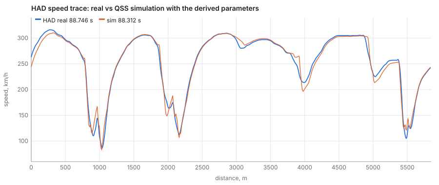
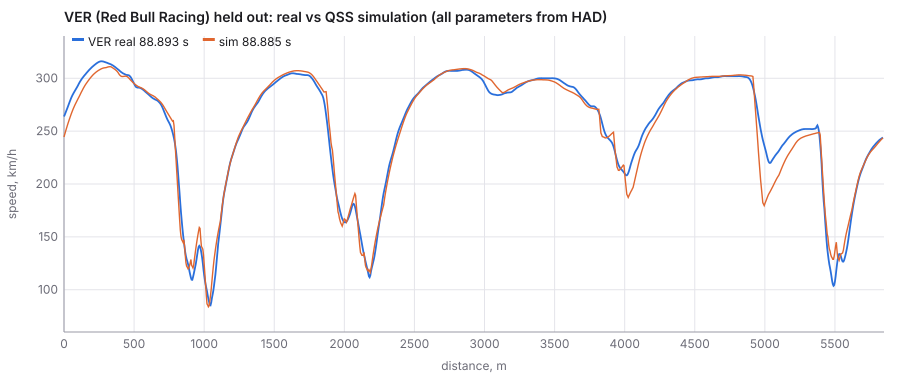
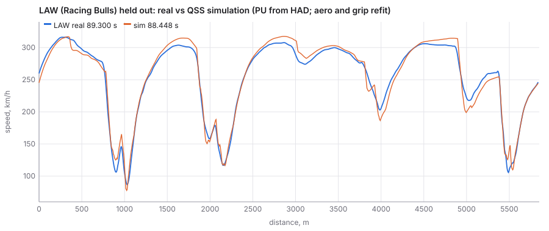
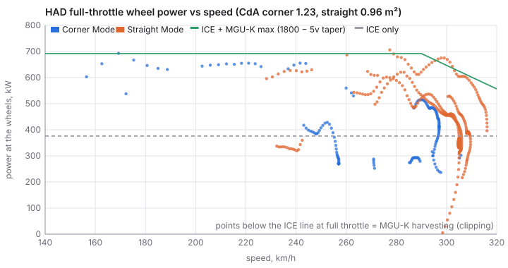
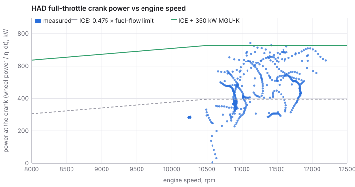
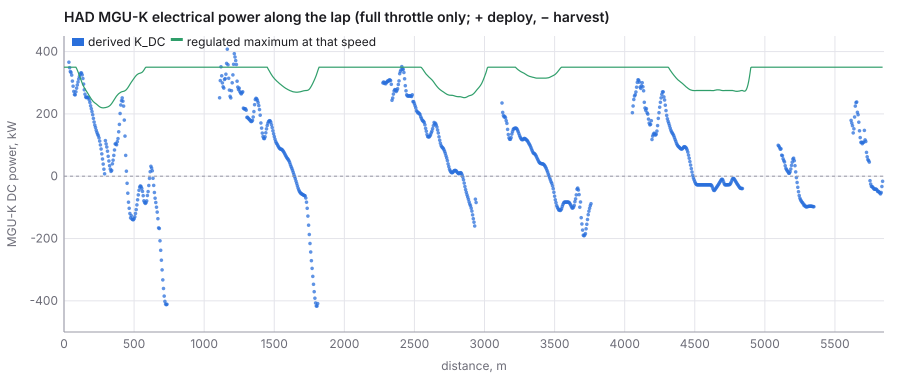
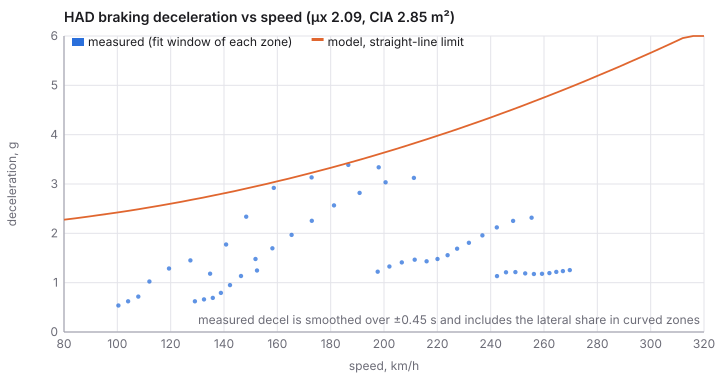
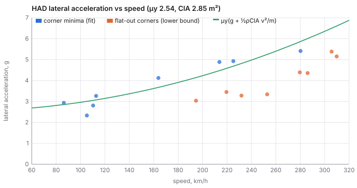

# Red Bull RB22 / Red Bull Ford DM01: physical parameters derived from telemetry

This is the Red Bull baseline car for PURPLE's physics lap simulator at Silverstone, worked out backwards from real 2026 qualifying telemetry. Competitor analysis from GPS and speed traces works the same way.

The rule from the owner is that **lap speeds must come out of the physics**. Telemetry is used only for two jobs: measuring what is not public (drag and downforce areas, tyre friction, gearing, how the MGU-K is deployed) and holding laps out for checks.

- **Consolidated sheet**: [RB22_SHEET.md](RB22_SHEET.md) carries this page's values next to the sim's and identify's, and re-measures gearing, shift points, braking, acceleration and cornering on all 25 Red Bull laps (9 circuits). Its all-lap gear table supersedes the HAD/VER table in §1 (4th gear 15.64 km/h per 1000 rpm, not 15.89; the median upshift is 12,045 rpm, of which 11,480 here is the last-sample lower bound).
- **Tool**: `concept/tools/derive-car.js` (Node, no dependencies). Run `node concept/tools/derive-car.js --write` to regenerate everything for Red Bull. `--all --write` does every team (see "All 11 teams" below). Add `--tel <dir>` to read lap files from another copy of the telemetry folder.
- **Output**: `concept/data/redbull-2026-derived.json` contains a full `PhysicalCar` (current contract, including `session`, `aero.floor_stalled` and `aero.stall_margin_mm`). Every field carries a kind (`regulation`, `derived-from-telemetry` with sd, or `assumption`). The file also holds `gearing`, `pu_curve`, the residuals, the sensitivity runs and the held-out checks.
- **Plots**: in `docs/concept/redbull-derived/` (SVG, light and dark).
- **Data**: OpenF1 qualifying session 11322 (4 July 2026). The fit lap is HAD's 88.746 s lap (lap 17, SOFT). The run that produced the committed JSON used all 22 qualifying laps from telemetry commit `bae7a51`. VER's 88.893 s lap is held out. With only the 11 laps on the base commit, the Straight Mode step has fewer samples and the run gives CdA_c 1.15 / CdA_s 0.99 (both well inside the ±1 sd). Regenerate once the 22-lap folder is merged. LAW and LIN (Racing Bulls, the same DM01 power unit) and the other 18 laps are further checks.
- **Air density**: taken from the weather samples during the lap (25.6 °C, 1007.4 hPa, 49 % relative humidity, Magnus vapour pressure), giving **ρ = 1.168 kg/m³**. Mean wind was 2.2 m/s from a variable direction. Wind is not modelled.

## Results

| Quantity | Value | ±1 sd | Kind | How |
|---|---|---|---|---|
| Mass (car, no fuel) | 779.5 kg | 10 | regulation + reported + assumption | C4.1 726 kg + Nominal Tyre Mass 44 kg (implied by the reported 768 kg race minimum) + Red Bull's reported +9.5 kg. Fuel is 5 kg (assumption) |
| ClA, Corner Mode (total) | **2.86 m²** | 0.94 | derived | cornering fit (§4) |
| μ_y (effective, soft) | **2.54** | 0.26 | derived | cornering fit (§4) |
| μ_y·ClA | 7.24 m² | strongly anti-correlated pair, so the product is much tighter than either | derived | cornering fit |
| CdA, Corner Mode | **1.23 m²** | 0.17 | derived | 350 kW deployment anchor (§2) |
| CdA, Straight Mode | **0.96 m²** | 0.16 | derived | CdA_c − ΔCdA, with ΔCdA = 0.27 ± 0.06 from the activation step (§2) |
| μ_x (braking, effective) | **2.09** | 0.25 | derived | speed-vs-distance fit in 6 brake zones (§3) |
| ICE power (≥ 10 500 rpm) | **396 kW** | 21 | regulation × assumption | η_th 0.475 ± 0.025 × 833 kW fuel energy flow (C5.2.3) |
| MGU-K | 350 kW DC, taper 1800 − 5v | | regulation | C5.2.7, C5.2.8 |
| ES deployed on the lap | **5.95 MJ** | ≈ ±1 | derived | ∫K_DC over full throttle |
| Gearing | 8 forward gears, 2nd to 8th used | | derived | §1 |
| Highest rpm seen | 12 536 (VER, 2nd gear); HAD 12 320 | | observed | Section C sets no rev limit |
| Upshift rpm | median 11 480 (p10 to p90: 10 969 to 11 873) | | derived | 40 upshifts on the HAD and VER laps |
| Aero balance (front share) | 0.43 | | assumption | not separable (§5) |
| Rolling radius | 0.348 m | 0.006 | assumption | 18 in rim (C10.7.2) and a ~707 mm tyre (press figure, unverified); loaded |

Each ± combines the statistical error of the fit with one-at-a-time sensitivity runs. Each run re-derives everything with one assumption moved across its band: η_th 0.45 to 0.50, mass ±10 kg, x/y smoothing τ 0.2 to 0.4 s, slip angle 0.04 to 0.12 rad, driveline efficiency 0.93 to 0.97, deployment anchor top-2 or top-4 straights, ΔCdA ± 2 se. The per-assumption table is under `sensitivity` in the JSON.

- **ClA**: x/y smoothing dominates (+0.63 / −0.40 m²).
- **CdA**: η_th (±0.09), ΔCdA (±0.09), slip angle (±0.07) and driveline efficiency (±0.07) dominate.

The degeneracy between ICE power and drag area matters less for lap time than for either number on its own. Raising η_th by one sd raises CdA_c to 1.32 m² through the anchor and changes the simulated lap by only **−0.10 s**.

## Method and equations

### Signal conditioning

The lap files hold OpenF1 samples (~3.7 Hz car data, ~3.9 Hz position) interpolated linearly in time onto a 5 m grid.

- **Speed and acceleration**: a local quadratic regression of speed against time over ±0.45 s gives smoothed v and dv/dt. A plain difference would differentiate the interpolation staircase.
- **Curvature**: from x/y after Gaussian smoothing over max(6 m, τ·v) with τ = 0.3 s (about one raw position sample), then κ = (x′y″ − y′x″)/(x′² + y′²)^1.5. The lap is closed, so the window wraps. Lateral acceleration is a_y = v²|κ|.
- **Straight Mode zones**: activation points come from the FIA event map (A1 65 m after T18, A2 55 m after T5, A3 155 m after T7, A4 65 m after T14). The map does not print zone ends, so each zone ends at the first lift or brake, or before Abbey for A1. The feed carries no active-aero flag.

### 1. Gearing

On every grid point that is clear of a gear change (same gear ±2 points, no brake, rpm > 6000), the tool forms v/ω_engine. The median per gear across the HAD and VER laps gives the overall ratio G = r/(v/ω), with r = 0.348 m.

| Gear | 2 | 3 | 4 | 5 | 6 | 7 | 8 |
|---|---|---|---|---|---|---|---|
| km/h per 1000 rpm | 10.52 | 12.99 | 15.89 | 18.94 | 21.89 | 24.97 | 27.98 |
| Overall ratio G | 12.47 | 10.10 | 8.26 | 6.93 | 5.99 | 5.25 | 4.69 |
| ±1 sd | 0.37 | 0.19 | 0.17 | 0.13 | 0.10 | 0.09 | 0.08 |

The km/h per 1000 rpm values are measured directly. The ratios scale 1:1 with the radius assumption, and the ±1.7 % from the radius dominates the sd in 6th to 8th gear. Low-gear spread comes from wheelspin and gear-change blur.

- **Gear 1** is not used on a flying lap.
- **Shift points**: median 11 480 rpm. Downshifts land at a median 10 829 rpm.
- **Highest rpm**: 12 536 (VER, 2nd gear, 130 km/h, on the Loop exit). Section C Issue 19 sets no rev limit.

### 2. Power, MGU-K and drag

On full-throttle points (≥ 99 %, no brake):

```
P_wheel = m_eff·v·a + ½ρ·CdA·v³ + C_rr·m·g·v + m·a_y·tan(α_slip·a_y/a_y,max)·v      (grade = 0: no elevation channel)
P_crank = P_wheel / η_dt                     η_dt = 0.95 (assumption)
P_ICE   = η_th · EF(rpm)                     EF = 3000 MJ/h ≥ 10 500 rpm, 0.27·N + 165 below (C5.2.3–4, regulated shape)
K_DC    = (P_crank − P_ICE)/η_K   (deploy)   or (P_crank − P_ICE)·η_K  (harvest),  η_K = 0.95
m_eff   = m + ΣI_wheel/r² + I_engine·G²/r²   (4.0 and 0.03 kg·m², assumptions)
```

- **C_rr** is 0.012 (assumption).
- **Slip drag**: the tyre-slip drag term carries the speed loss through Abbey and Farm at full throttle. The slip angle at the limit is 0.08 rad (assumption, varied 0.04 to 0.12).

**The degeneracy.** Speed and throttle alone cannot separate drag area from power. A higher CdA with more MGU-K deployment explains the same trace as a lower CdA with less, because the deployment strategy is not public. Two regulation facts break the tie:

1. **The ICE curve shape is regulated.** Fuel energy flow is capped, so ICE power is η_th × 833 kW above 10 500 rpm, and only η_th is unknown. The band is 0.45 to 0.50 (375 to 417 kW). This is an assumption anchored on the regulated fuel flow. No DM01 figure is published, and reported generic figures are around 400 kW.
2. **The MGU-K cap is regulated.** In a qualifying lap the car deploys the full 350 kW out of the best corner exits. The tool takes each full-throttle run, finds its peak K_DC (25 m running median, below 285 km/h where the cap is flat), and solves CdA_c so that the mean of the top three peaks equals 350 kW.

The peaks come out at 371, 343 and 336 kW (Wellington, Woodcote–Copse and pit straight), then 302 (Hangar), 225 (Club exit), 195 (Copse exit) and 92 (Vale straight). So the car deploys fully only out of the slow corners that lead onto long straights.

**Straight Mode step.** At an activation point the PU output does not jump, so a step in apparent power across the flap opening equals −ΔCdA·½ρv³. The tool measured this on all 22 laps, keeping windows of 1.0 to 0.15 s before and 0.35 to 1.2 s after activation, with full throttle and below 1.5 g lateral. It gives **ΔCdA = 0.27 ± 0.06 m²** (n = 19 lap-zones: 18 in A3, 1 in A4). A2 and A4 mostly fail the lateral filter because Aintree and Chapel sit just before them. Without that filter, A4 alone gives a consistent 0.17 to 0.33 over 11 laps, depending on how slip drag is treated.

**Energy and clipping.** With these parameters the lap's full-throttle balance is:

| | MJ |
|---|---|
| MGU-K deployed (DC) | 5.95 |
| Harvested at full throttle ("super clipping") | 1.56 |
| Brake-phase harvest, upper bound (350 kW × braking time above 100 km/h) | 3.32 |
| Silverstone qualifying recharge limit | 6.5 |
| Most that can be deployed (recharge + 4 MJ SoC window) | 10.5 |

Total harvest (≤ 4.9 MJ) is under the 6.5 MJ limit, and the net drawn from the store (≥ 1.1 MJ) is inside the 4 MJ window, so the derived set is consistent with the energy rules. The **clipping signature** is speed falling at 100 % throttle on a straight, with K_DC negative. It appears at:

- pit straight to Abbey and Farm (296 → 295 and 270 → 266 km/h, K down to −412 kW, part of which is unmodelled cornering load)
- end of the Wellington Straight, 1680 to 1810 m (306 → 292 km/h, −417 kW)
- the run to Copse, 2860 to 2930 m (−160 kW)
- Maggotts, 3575 to 3625 m (−102 kW)

The Hangar Straight instead sits at a flat 305 km/h for 400 m. K_DC is about −60 kW there: the PU holds the speed while harvesting gently. See `mguk-vs-distance.svg`.

### 3. Braking

Peak deceleration from a 3.7 Hz trace is smeared, so the tool fits the **speed-vs-distance trace** of each brake zone instead of its derivative. Each zone runs from brake onset + 0.25 s until speed has fallen 70 % of the way to the corner minimum. Over that window the tool integrates:

```
dv/ds = −[ sqrt((μ_x·N)² − (m·a_y)²) + ½ρ·CdA_c·v² + C_rr·m·g ] / ((m + I_w/r²)·v),   N = m·g + ½ρ·ClA·v²
```

The friction circle uses the measured a_y, so curved zones such as Brooklands are included.

**Result: μ_x = 2.09.** The zones give Village 1.83, Loop 1.96, Brooklands 2.14, Luffield 2.19, Stowe 2.00 and Vale 2.73. The sd across zones goes into the ±, and the RMS speed residual is 8.1 km/h.

A joint (μ_x, CdA_c) fit from braking alone runs to the edge of its grid. Drag is only 10 to 20 % of braking deceleration, which is inside the noise. Braking therefore cannot supply CdA, and the CdA comes from §2.

### 4. Cornering

The fit uses grip-limited corners only: a local speed minimum at least 15 km/h below the preceding peak. There are 8 on HAD's lap: Village, The Loop, Brooklands, Luffield, Copse (HAD lifted), Becketts, Stowe and Vale–Club. The simulator's corner speed is set by the largest |κ| near the apex, so the fit uses the same quantity, a_y = v_min²·max|κ| within ±40 m. Fit and simulator therefore share the same smoothing and the same bias.

```
a_y = μ_y·(g + ½ρ·ClA·v²/m)        linear in (μ_y, μ_y·ClA)
```

**Result: μ_y = 2.54, ClA = 2.86 m², RMS 0.39 g.** The residual pattern is systematic:

- **Mid-speed corners** (Brooklands 4.12 g vs model 3.67, Becketts 4.89 vs 4.48, Stowe 4.93 vs 4.69) run above the line.
- **Copse** (5.41 vs 5.87) and **Vale–Club** (2.33 vs 3.01) run below it.

Tyre load sensitivity would bend the line the right way. A third parameter is not identifiable from 8 corners, though: the fit runs to the edge of its ClA grid. So `load_sens = 0` and both μ values are *effective* values at the loads seen on this lap.

The 8 flat-out corners all sit below the model line (Abbey 5.4 g at 306 km/h against 6.5 g available), as a lower bound should. For comparison, the same method gives μ_y·ClA = 8.8 m² for ANT (Mercedes) against 7.2 m² for HAD. That fits HAD's time loss to pole in the fast corners (Becketts, Stowe) at an equal top speed.

### 5. Aero balance

Speed, throttle and x/y carry no axle information, so front and rear ClA cannot be separated. The traction-limited corner exits depend on rear load, but they are too few and too driver-shaped to fit. The JSON splits ClA 0.43 / 0.57 (assumption). The regulation axle-mass bounds (front ≥ 0.44, rear ≥ 0.54 of the minimum, C4.2) and a slightly rearward aero balance for high-speed stability support that split. Straight Mode ClA is not measured, because there is no cornering in Straight Mode, and it is set equal to Corner Mode as an upper bound.

## Simulation check (QSS)

`simulate()` is a standard quasi-steady-state lap. It uses the lap's own smoothed κ(s), geometric Straight Mode zones, and the derived parameters.

- **Corner limit**: v_c = sqrt(μ_y·g / (|κ| − μ_y·ρ·ClA/2m)).
- **Forward pass**: ICE at η_th × fuel flow in the best gear below the p90 shift rpm, plus the MGU-K, against a rear-axle traction limit on the friction circle.
- **Backward pass**: braking in Corner Mode on the friction circle.
- **Lap start**: periodic.
- **MGU-K strategy**: the team-level unknown measured in §2. K_DC follows the derived profile along the lap (by lap fraction) where HAD was at full throttle, and is 0 elsewhere. A speed-only deployment map fails: the same speed means deploy on one straight and harvest on another (`sim_fit_lap_speed_map_strategy` in the JSON).



| Lap | Role | Real s | Sim s | Δ s | Speed RMS km/h | V_max real / sim km/h |
|---|---|---|---|---|---|---|
| HAD | fit lap | 88.746 | 88.312 | −0.43 (−0.49 %) | 8.0 | 316 / 310 |
| **VER** | **held out, same car, nothing refit** | 88.893 | 88.885 | **−0.01** | 9.9 | 316 / 311 |
| **LAW** | **held out, Racing Bulls DM01: PU frozen, ClA, μ_y, CdA, μ_x refit on LAW's lap (own mass)** | 89.300 | 88.643 | **−0.66 (−0.74 %)** | 9.2 | 316 / 316 |
| LIN | same as LAW | 89.305 | 88.054 | −1.25 (−1.4 %) | 9.2 | 315 / 318 |
| 18 other laps (other PUs, PU frozen at DM01) | indicative only | | | median 0.00, mean abs 1.16 (STR +3.7) | 8 to 22 | |

**Reading the table.**

- **VER**: the near-zero lap-time error is partly luck. Corner by corner the simulator is 4 to 17 km/h off (below), and the errors cancel. The speed RMS of ~10 km/h is the honest figure.
- **HAD**: the QSS lap is 0.4 s quicker than the real one, as expected from an ideal-driver model. The real lap spends 36 % of its time at part throttle.
- **LAW and LIN**: the refit Racing Bulls cars are 0.66 to 1.25 s quick for the same reason. Their fitted ClA and μ_y trade against each other (LAW 2.10 / 2.61, LIN 2.64 / 2.55).
- **Other teams**: with the PU frozen at Red Bull's, a different ICE ends up in their CdA, so these laps are indicative only. STR's lap carries a trace glitch (a 1045 kW "deployment peak"). Peaks above 700 kW are discarded as glitches, and the lap still sims 3.7 s slow.

Corner minima on HAD's lap, real vs sim (km/h):

| Corner | Village | Loop | Brooklands | Luffield | Copse | Becketts | Stowe | Vale–Club |
|---|---|---|---|---|---|---|---|---|
| Real | 110 | 86 | 164 | 113 | 280 | 214 | 225 | 105 |
| Sim | 115 | 83 | 149 | 107 | 290 | 197 | 214 | 121 |

The mid-speed corners come out slow and Copse and Vale–Club fast, which is the cornering-fit residual pattern of §4. Lap-time sensitivity of the simulation to +1 sd of each parameter: CdA_c +1.63 s, CdA_s +0.86 s, ClA −2.17 s, μ_y −1.92 s, μ_x −0.27 s, and η_th with CdA re-derived −0.10 s. ClA and μ_y are strongly anti-correlated, so their joint effect is much smaller than the sum.




## Plots







## All 11 teams (`concept/data/cars-2026-derived.json`)

`node concept/tools/derive-car.js --all --write` runs the same derivation for every team on its two qualifying laps. `--driver CODE` or `--team <id>` prints one car. For each team the run produces:

- **A central fit** on the faster driver's lap.
- **300 bootstrap replicates.** Each replicate takes one of the team's two laps at random, then resamples that lap's grip-limited corners, full-throttle straights and brake zones with replacement.
- **A teammate held-out check**: fit on one driver, then simulate the other driver's lap with that car and that driver's MGU-K profile, in both directions.
- **A PhysicalCar-shaped estimate**, with central, mean ± sd, median, robust sd (half the 16 to 84 % range) and the 5 to 95 % range for every parameter.

A resample of 8 corners can be ill-conditioned, so the table below gives the central value ± the robust sd. ΔCdA (Straight Mode, 0.27 m²) is shared by all cars.

| Team | PU | Fit lap | Mass kg | CdA_c m² | ClA m² | μ_y | a_y at 150 km/h, g | a_y at 250 km/h, g | μ_x | Fit-lap sim Δ s | Teammate held out Δ s |
|---|---|---|---|---|---|---|---|---|---|---|---|
| Mercedes | Mercedes M17 | ANT 88.111 | 770 | 1.08 ± 0.18 | 3.4 ± 1.4 | 2.58 ± 0.38 | 3.73 ± 0.23 | 5.79 ± 0.68 | 1.79 ± 0.36 | −1.23 | ANT→RUS −2.00, RUS→ANT +0.75 |
| Ferrari | Ferrari 067/6 | LEC 88.286 | 770 | 1.21 ± 0.14 | 5.2 ± 1.7 | 2.15 ± 0.30 | 3.66 ± 0.18 | 6.34 ± 0.44 | 1.50 ± 0.30 | +0.24 | LEC→HAM −0.10, HAM→LEC +0.81 |
| McLaren | Mercedes M17 | NOR 88.877 | 770 | 1.30 ± 0.14 | 2.8 ± 1.2 | 2.42 ± 0.49 | 3.35 ± 0.31 | 4.99 ± 0.49 | 1.89 ± 0.46 | +0.17 | NOR→PIA +1.71, PIA→NOR −1.56 |
| **Red Bull** | **Red Bull Ford DM01** | **HAD 88.746** | **779.5** | **1.23 ± 0.11** | **2.9 ± 1.2** | **2.54 ± 0.30** | **3.49 ± 0.16** | **5.19 ± 0.49** | **2.09 ± 0.33** | **−0.43** | **HAD→VER −0.01, VER→HAD +0.77** |
| Racing Bulls | Red Bull Ford DM01 | LAW 89.300 | 774.5 | 1.11 ± 0.16 | 2.1 ± 1.1 | 2.61 ± 0.36 | 3.34 ± 0.16 | 4.64 ± 0.50 | 2.18 ± 0.34 | −0.29 | LAW→LIN +0.52, LIN→LAW −1.35 |
| Alpine | Mercedes M17 | GAS 90.063 | 772 | 0.90 ± 0.28 | 2.3 ± 1.0 | 2.43 ± 0.30 | 3.18 ± 0.21 | 4.52 ± 0.48 | 2.08 ± 0.43 | +0.53 | GAS→COL +0.11, COL→GAS +0.53 |
| Haas | Ferrari 067/6 | BEA 90.501 | 771 | 1.15 ± 0.12 | 2.2 ± 1.1 | 2.67 ± 0.47 | 3.44 ± 0.24 | 4.82 ± 0.37 | 2.14 ± 0.42 | −0.23 | BEA→OCO +3.38, OCO→BEA −1.61 |
| Audi | Audi AFR 26 | BOR 89.461 | 770 | 1.16 ± 0.12 | 2.3 ± 1.3 | 2.54 ± 0.29 | 3.33 ± 0.17 | 4.74 ± 0.60 | 1.99 ± 0.29 | +1.15 | BOR→HUL +0.77, HUL→BOR +0.34 |
| Williams | Mercedes M17 | SAI 90.562 | 796 | 1.23 ± 0.26 | 2.9 ± 2.0 | 2.54 ± 0.41 | 3.50 ± 0.21 | 5.21 ± 0.61 | 1.71 ± 0.38 | +0.35 | SAI→ALB −0.53, ALB→SAI +1.46 |
| Aston Martin | Honda RA626H | STR 92.863 | 779.5 | 1.59 ± 0.10 | 2.0 ± 0.9 | 2.64 ± 0.34 | 3.32 ± 0.19 | 4.54 ± 0.24 | 1.40 ± 0.34 | +3.19 | STR→ALO +2.54, ALO→STR +0.72 |
| Cadillac | Ferrari 067/6 | BOT 91.227 | 776.5 | 0.88 ± 0.27 | 3.2 ± 1.6 | 2.16 ± 0.38 | 3.08 ± 0.16 | 4.72 ± 0.58 | 1.68 ± 0.44 | +0.34 | BOT→PER +0.22, PER→BOT +0.34 |

**Teammate held-out check** (22 checks): median absolute lap-time error 0.77 s, mean +0.35 s, RMS 1.31 s, median speed-trace RMS 10.5 km/h. The largest misses are BEA→OCO +3.4 s (OCO's distance axis is the known outlier, 5885 m) and STR→ALO +2.5 s (STR's lap carries a 1045 kW trace glitch).

**What the table supports:**

- **Fast-corner grip** (lateral limit at 250 km/h): Ferrari 6.3 g and Mercedes 5.8 g sit above Red Bull 5.2 g. That matches HAD losing his time to pole in Becketts and Stowe at an equal top speed.
- **Slow-corner grip** (at 150 km/h) is much closer across teams: 3.1 to 3.7 g.
- **ClA and μ_y separately** are poorly determined (ClA ± 1 to 2 m²). Their product and the lateral limits at given speeds are the robust numbers.
- **CdA_c is conditional on one ICE assumption for all power units** (η_th 0.475). An ICE weaker than assumed shows up as a higher CdA_c, because the 350 kW anchor then needs more drag to explain the same acceleration. Aston Martin's 1.59 m² (ALO's lap gives 1.54 m²) is best read as "weaker PU and/or more drag", not as drag alone. Compare CdA_c directly only within a PU family.
- **Mass** uses the reported April over-minimum figures (Williams +26 kg).

**Multi-circuit.** Everything circuit-specific is in the tool's `CIRCUITS` registry: lap files, corner markers, weather, Straight Mode activation points, corner names and the recharge limit. New circuits (`concept/data/telemetry/<circuit>/`, same file conventions) can be added there. The next step is a joint fit that shares μ, the PU and each car's ClA/CdA efficiency, with a per-circuit wing level (ClA and CdA scale).

**Priors.** No priors file was present during this run (`concept/data/priors-2026.json`). When it lands, its ranges should replace the fixed assumption bands: η_th per PU, mass, tyre radius and aero balance.

## Limitations

- **Sampling.** The telemetry is ~3.7 Hz resampled to 5 m, so peak deceleration and short events are smeared. Braking is therefore fitted on v(s), and the last 0.45 s before every lift or brake is masked from the power analysis because the ±0.45 s speed fit reaches into the brake zone.
- **Distance.** Distance is the integral of speed (lap lengths 5806 to 5842 m against an x/y length within 0.5 %). Corner positions can be ~10 to 20 m off, and OCO's lap is an outlier.
- **Curvature.** Curvature comes from ~4 Hz positions that are good to a few metres. ClA depends on the smoothing scale (±0.5 m² over τ 0.2 to 0.4 s). Fit and simulator use the same smoothing, so lap times are less sensitive than ClA itself.
- **Drag and ICE power** are not separately observable. CdA rests on two things: the regulated fuel flow × an efficiency band, and the assumption that the MGU-K reaches its 350 kW cap on the best three corner exits. If the DM01's efficiency were outside 0.45 to 0.50, CdA would move by ~0.18 m² per 0.05.
- **Straight Mode drag reduction** comes essentially from one zone (A3) and assumes the PU holds its output across the flap opening. The feed carries no active-aero flag.
- **Wind** (0.3 to 4.9 m/s, variable direction), **elevation and grade** (no channel) and **kerb use** are not modelled. A 1 % grade is worth ~6 kW at 80 m/s.
- **Tyre rolling radius** is an assumption: 18 in rim from C10.7.2, with the 2026 tyre diameter taken from unverified press figures. It scales every gear ratio 1:1. The km/h per 1000 rpm values are measured and do not depend on it.
- **Fixed assumptions.** Mass, fuel, rotating inertia, η_dt, η_K, C_rr, slip angle, aero balance, CoG height (0.28 m above the ground, including plank and ride height), wheelbase (3.4 m regulation maximum) and track widths (1.540 / 1.470 m, the C10.10.1 maxima; 1.58 / 1.52 m before, outside the rule) are assumptions with stated values. The ones that matter are varied in the sensitivity runs.
- **μ values** are effective values for a fresh soft tyre at 38 to 44 °C track temperature on this lap, with no load sensitivity.
- **Race laps.** The race laps added to the telemetry folder (HAD and VER) are not used: they differ in fuel, tyres and recharge limit (8 MJ, Overtake).
