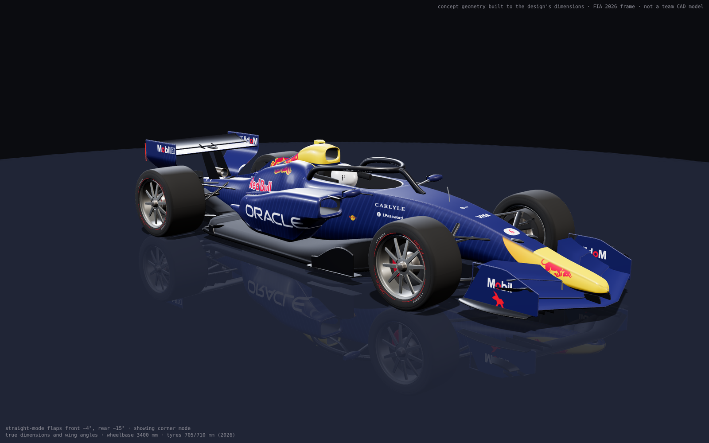
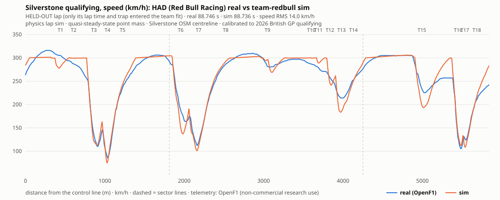
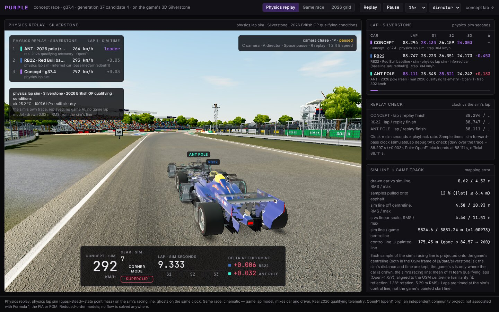
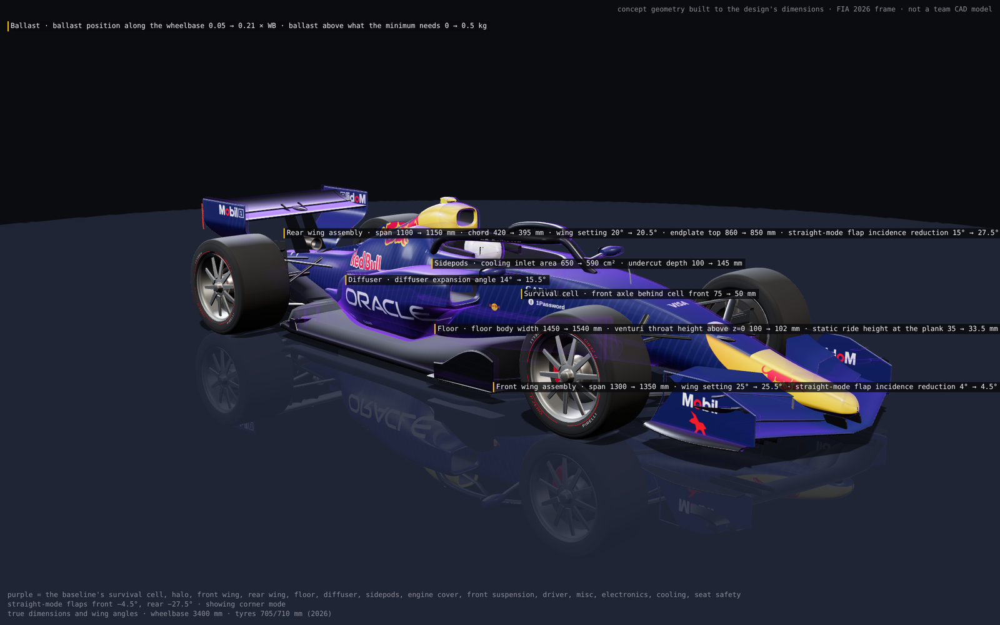

<!-- _paginate: false -->
<!-- _class: lead -->

PURPLE · Night Shift London · 2026-10-24 · built around Mubit

# An AI race engineer redesigns the 2026 Red Bull RB22 to beat the real Silverstone pole

Same Red Bull Ford DM01 power unit · every car checked against FIA 2026 Section C · Mubit proposes the next change, a physics lap sim measures it, the measured result goes into the next call.

best legal RB22 / DM01 car · model prediction ± band

87.235 ± 0.154 s

95 % band 86.933–87.537 s · real 2026 pole ANT <b>88.111 s</b> (−0.876) · real HAD RB22 <b>88.746 s</b> (−1.511) · would be P1 across the band

RB22 baseline, built procedurally from the design's 23 parameters · "concept geometry built to the design's dimensions · FIA 2026 frame · not a team CAD model"

our car: physics lap sim · Silverstone · 2026 British GP qualifying conditions (docs/concept/CAMPAIGN.md §4.0) · real laps: real 2026 qualifying · OpenF1 / formula1.com

<!--
Speaker notes: One sentence: we built an AI race engineer for the 2026 rules. It takes the Red Bull RB22 with its own Red Bull Ford DM01 engine, redesigns the car part by part inside the FIA 2026 technical regulations, and measures every change on a physics lap simulation of Silverstone. Mubit is in the loop: every designer call carries the previous changes and their simulated results. The headline number is a model prediction with its own error band, never a claim about a real car.
-->

---

# What is new this weekend
<small>Fresh-code rule: all project code written during the event</small>

<h3>Pre-existing (not judged as new)</h3>

**Equation I**, our team's browser F1 game: `js/` `css/` `assets/` `vendor/` `tools/` `index.html`. Imported as one commit, `a711399`, Fri 2026-10-23 21:54 UTC, labelled "pre-existing".

PURPLE uses its 3D Silverstone, its car model and its race engine.

<h3>New this weekend (365 commits since Fri 22:47 BST)</h3>

- `concept/`: design layer, FIA checklist, physics lap sim, campaign, Mubit designer loop, 3D car, Silverstone replay
- `server/`: Hono API, the one Mubit client (`server/mubit.js`), engine dashboard routes
- `lab/`: the 5-knob research lab · `test/`: 29 suites, 326 tests · `docs/`
- **Game hooks, opt-in:** 7 game files, +633 / −48 lines: `?lab=1` (race result to the lab), `?concept=1` (concept replay, new `js/conceptrace.js`), aero inputs in `car.js` `ai.js` `carmodel.js` `race.js`, one script tag in `index.html`. Without the flags the game behaves as before.

git history: `git diff --stat a711399 HEAD -- js css index.html` · ARCHITECTURE.md §9 (hooks) · repo github.com/rayhankhilji/purple

<!--
Speaker notes: Equation I is ours and predates the weekend; it came in as one import commit on Friday night and we do not claim it. Everything PURPLE does (the lab, the server, the concept car, the physics, the Mubit loop, the tests) was written here, and the game was touched only through opt-in hooks behind URL flags.
-->

---

# The problem
<small>2026 is a rules reset; a team needs to know what to try next</small>

- **The question.** Can a car that obeys FIA 2026 Section C (Issue 19, in force at Silverstone) and keeps its own power unit lap Silverstone faster than the real 2026 pole?
- **The baseline.** Red Bull RB22, Red Bull Ford DM01. Real qualifying: HAD **88.746 s** (P5); pole ANT (Mercedes) **88.111 s**.
- **Why it is hard.** 23 shape parameters plus materials, coupled through the rules (front-wing X+Z envelope, floor stall, mass and axle split, Straight Mode flaps) and through the lap (drag paid on every straight, grip earned in a few corners).
- **What an engineer needs** is the next change to try, with the evidence of the last ones, and a verdict that comes from a measurement, not from the model that proposed it.

<h3>Ground rules we set ourselves</h3>

- same engine: DM01 locked field by field (ICE 396.08 kW, MGU-K 350 kW, ES 4 MJ window)
- illegal car = no lap, no score
- the verdict is the simulator's, never the LLM's
- every number carries its source

real laps: real 2026 qualifying · OpenF1 / formula1.com · regulations: FIA 2026 F1 Technical Regulations Section C, Issue 19 · PU values: docs/concept/CAMPAIGN.md §4.0

<!--
Speaker notes: The 2026 cars are new: active aero with Straight and Corner mode, a power unit that is half electric, new tyres. Nobody has a settled answer for where the lap time is. Our agent's job is the engineer's daily question: given what the last changes did, what do we try next? The power unit cannot change, the car must stay legal, and the simulator, not the model, decides what is kept.
-->

---

<!-- _class: dense -->

# How it works
<small>Real data in, a legal car out, every step measured</small>

<b>1 · Real data</b>OpenF1 qualifying telemetry (22 laps at Silverstone, 9 circuits) · FIA Section C · formula1.com times

<b>2 · The car</b>RB22 estimated from public telemetry; 23 shape parameters, 23 materials; DM01 locked

<b>3 · Legal?</b>94-row FIA 2026 checklist in <code>regs.js</code> + same-engine and material guards

<b>4 · Lap</b>physics lap sim, Silverstone, 2026 British GP qualifying conditions: lap, sectors, per-corner Δ

<b>5 · Kept?</b>legal and faster, computed from the sim's numbers

↑ proposals come from two engines ↓ results go back

<b>Mubit designer task (the judged loop)</b>Claude Haiku 4.5 through Mubit, frozen prompt v1. Each call receives the current best car + the last 3 tested changes with measured lap, sector and segment deltas, kept or not, FIA articles. Returns 1–3 parameter changes. One Mubit session per run, one request id per result.

<b>Speed run (no LLM)</b>CMA-ES on the physics sim with a surrogate pre-screen, on worker threads, 37 laps/s on a loaded 4-CPU box. Finds the fastest legal car. <b>Autonomous mode</b> joins the two: Mubit sets the direction, a legal-only local search of up to 200 physics laps exploits it.

↓

<b>Engine dashboard</b><code>/concept/lab/</code> → Engine: speed run · autonomous Mubit · garage · RB22 car sheet

<b>3D car</b>built from the parameters at true size; hot swap of any part or material

<b>Silverstone replay</b>the sim's own lap on the game's 3D track, ghosts: RB22 and ANT's real pole lap

docs/concept/LOOP.md · DASHBOARD.md · SIM.md · FIA_CHECKLIST.md · MATERIALS.md · RACE.md · laps/s measured in DASHBOARD.md §2 (6,740 laps in 184 s)

<!--
Speaker notes: Left to right is one evaluation: data, car, legality, lap, verdict. Proposals come from two engines. The Mubit designer is the learning loop the judges asked about; the speed run is a classic optimiser that shows how far the physics lets the car go. The autonomous mode uses Mubit to choose the direction and a short local search to make the most of each proposal. Everything is visible in the dashboard, the 3D car and the replay.
-->

---

<!-- _class: dense -->

# The Mubit loop, one real call
<small>Trained run seed 11 · session loop-01m5pgpkgspft7dtx7dz1gqrre · iteration 3</small>

<pre class="req"><i>POST api.mubit.ai/anthropic/v1/messages · claude-haiku-4-5 · max_tokens 250 · temperature 0
system: designer prompt v1 (frozen, 994 chars) · metadata.user_id: the run id = one session
user message, 1,592 chars ≈ 398 tokens (line breaks added, … = cut here):</i>
{"best":{"lap_s":88.656,"gap_s":0.545,"kg":770,"front":0.45,"params":{<i>…23 by part…</i>}},
 "tested":[
  {"change":"survival_cell.bulkhead_gap_mm 380->360; floor.ride_height_mm 35->33.5;
             rear_wing.sm_delta_deg 15->20",
   "d_lap_s":<b>-0.096</b>,"ds":[-0.02,-0.104,0.028],"kept":<b>true</b>},
  {"change":"rear_wing.aoa_deg 20->20.5; ballast.x_frac 0.05->0.04",
   "d_lap_s":<b>0.041</b>,"ds":[0.014,0.077,-0.05],"kept":<b>false</b>,"by":"fallback",
   "gain":["Hangar Str -0.053","Wellington Str -0.023"],
   "loss":["Copse-Maggotts +0.041","Maggotts-Becketts-Chapel +0.032"]}],
 "refused":[{"change":"front_wing.sm_delta_deg 4->6; sidepods.inlet_cm2 650->620;
             rear_wing.endplate_top_mm 860->840","why":<b>"illegal C3.10.10(s)(i)"</b>}],
 "near":["floor.ride_height_mm 33.5 (min 33.5 PKG-FLOOR-STALL)",
         "front_wing.span_mm 1300 (max 1300 C3.10.1(a))", <i>…7 more</i>]}</pre>

| call mode | what Mubit keeps (per its docs, LOOP.md §3) |
|---|---|
| untrained (`x-middleware-record: metadata`) | a record without request or reply; never a kept example |
| **trained** (this call) | request + reply in the **designer task**, session = run id; may become a kept example (first adapter trains at 25) |

<h3 class="mubit">← Mubit answers · mreq_01a16d0b7587…</h3>

`rear_wing.aoa_deg 20→19.5` · `sidepods.inlet_cm2 650→630` · `ballast.x_frac 0.05→0.06`
"Reduce rear wing AoA for lower drag on straights; moderate sidepod inlet …"

<h3>= the physics lap sim measures</h3>

**88.656 → 88.638 s (−0.018)** · sectors −0.012 / +0.058 / −0.065 · gained Hangar Str −0.094 · legal · **KEPT**

<h3>→ fed to the next call</h3>

This result is `tested[]` in iteration 4's request `mreq_01a16d0b80e1…` (lineage `loop.fed_to`). Trained calls store it in Mubit with the next proposal.

docs/concept/loop-runs/trained-seed11/lineage.jsonl row 3 (`loop.scenario`, `loop.mubit_request_id`, `loop.fed_to`) · laps: physics lap sim · Silverstone · 2026 British GP qualifying conditions (sim v2 at the time of this run)

<!--
Speaker notes: This is the exact user message Mubit received, shortened only where marked. The model sees what its own earlier proposal did: the first change was kept and gained a tenth, the second was slower and came from the seeded fallback, one proposal was refused as illegal under C3.10.10. It proposes three changes; the physics sim measures them; they are kept on the numbers. Mubit has no API to attach an outcome to a call, so the honest mechanism is this one: the result travels in the next call's input, and when calls are trained Mubit stores that input with the next proposal, which is what its examples and adapters learn from.
-->

---

<!-- _class: dense -->

# Mubit in numbers
<small>Every call has a request id; every result knows which later call carried it</small>

| Mubit designer runs | runs (sessions) | iterations | Mubit calls | trained | LLM proposal used | kept (proposed by LLM) | best lap · Δ baseline |
|---|---|---|---|---|---|---|---|
| live untrained, prompt tuning | 3 | 13 | 13 | 0 | 7 of 13 | 3 (3) | 88.667 · −0.085 |
| trained, prompt v1 frozen (sim v2) | 4 | 60 | 60 | 60 | 52 of 60 | 9 (9) | 88.612 · −0.140 |
| trained, big run (sim v3) | 12 | 300 | 271 | 271 | 199 of 271 | 66 (39) | **88.292 · −0.471** |

- **331 trained designer calls, 331 unique request ids, 16 sessions**; 315 results fed into a later call (the last of each run has no successor).
- Refused answers (63 illegal, 9 duplicates in the big run) are replaced by one seeded fallback step and marked `by: "fallback"` in the next input; 29 iterations made no call (designer paused after 3 failures).
- Project budget: 99 research + 331 designer = **430 of 2,500** trained calls. Median latency 2.3 s, ≈ 1,030 tokens in, 191 out.
- Mubit loop alone, 25 calls a run: best 88.292 s, still +0.181 s to pole. The 87.235 s car comes from the speed run.

<h3 class="mubit">Mubit console · designer task (owner reads)</h3>

- kept examples: FILL designer-kept
- adapter status / test result: FILL designer-adapter
- Try models, same scenarios, legal-and-faster proposals: provider FILL n/N · adapter FILL n/N

docs/concept/loop-runs/*/{calls,lineage,summary} as of 2026-10-24 09:53 UTC · laps: physics lap sim · Silverstone · 2026 British GP qualifying conditions · baselines 88.752 s (sim v2) / 88.763 s (sim v3) · budget: EVAL_GUARDRAILS §4

<!--
Speaker notes: Three groups of runs. The untrained runs tuned the prompt, then we froze it. Sixty trained calls on four seeds, then a twelve-run, three-hundred-iteration trained run. Every row in the lineage stores the call's request id and the id of the later call that carried its result. The Mubit loop on its own improves the car by half a second in 25 calls; it does not reach pole, and we say so. The console numbers (kept examples, adapter, Try models) are read by hand from the Mubit console and go in the amber boxes.
-->

---

<!-- _class: dense -->

# The physics
<small>Speeds come out of the physics; telemetry estimates the unknowns and checks the result</small>

- **Physics lap sim v3**: quasi-steady point mass with axle load transfer, power-law tyre load sensitivity, ride-height aero and floor stall, Straight / Corner Mode only in the FIA zones, the C5.12 power-reduction rules, wind, density, gradient. ~21 ms a lap. No per-corner factors.
- **Estimated on one lap** (ANT's pole trace), checked on the other 10 teams' laps: held-out speed RMS **10.1 km/h** (target < 7: **missed**), sector bias +0.172 / +0.015 / −0.192 s. RB22 baseline 88.763 s vs HAD's real 88.746 s.
- **FIA checklist**: 94 rows against Section C Issue 19 (45 checked, 9 when a material is set, 13 partial, 4 not checked, 23 fixed / not applicable); an adversarial oracle on ~1,450 designs agrees rule by rule.
- **Materials**: 23 materials with their C15 reading; survival cell must be CC-UHS. **Coupling**: all 23 shape parameters reach the simulated car with a plausible sign.
- **Identification**: 11 cars over 9 circuits, 194 OpenF1 laps, bootstrap mean ± std.

HAD's real 2026 qualifying lap (OpenF1) vs the sim's Red Bull car, speed over distance, RMS 9.7 km/h

physics lap sim · Silverstone · 2026 British GP qualifying conditions (docs/concept/SIM.md §0, §7) · FIA_CHECKLIST.md summary · MATERIALS.md · COUPLING.md · IDENTIFY.md · telemetry: OpenF1, an independent community project

<!--
Speaker notes: The simulator is a reduced-order model, not a flow solver. It gets its speeds from forces and the 2026 energy rules. Four unknowns are estimated on the pole lap only, inside sourced prior ranges; the corner-mode downforce range had to be widened from 4.6 to 6.5 because the measured lateral accelerations at Brooklands, Becketts and Stowe are unreachable inside it. It misses its own accuracy target: 10.1 km/h held-out RMS against a target of under 7. Every candidate passes a 94-row FIA checklist before it gets a lap.
-->

---

<!-- _class: dense -->

# The result
<small>Best legal RB22 / DM01 car · model prediction ± band</small>

| | lap (s) | Δ pole 88.111 | Δ HAD 88.746 | grid |
|---|---|---|---|---|
| RB22 baseline (sim) | 88.763 | +0.652 | +0.017 | P6 |
| **best legal car** | **87.235 ± 0.154** | **−0.876** | **−1.511** | **P1** (95 %: P1–P1) |
| aero map gains halved | 87.893 | −0.218 | −0.853 | |

95 % band **86.933–87.537 s**: the whole band is below the real pole. 4 seeds × 5,000 physics laps + refinement.

- **PU identical** to the homologated DM01 (ICE 396.08 kW, MGU-K 350 kW); energy 7.633 MJ deployed, 3.657 of 6.5 MJ recharged.
- **At FIA limits**: floor width 1540, rear-wing span 1150, endplate 880, front-wing span 1350, bulkhead gap 360 mm. Floor throat 66.5 mm (roof 75).
- **Worth most**: Straight Mode flap angles −0.381 s, sidepods −0.276 s.

<h3>Where the 1.528 s comes from (per corner, best − baseline)</h3>

Stowe (T15)−0.258

Brooklands (T6)−0.215

Becketts (T13)−0.212

Luffield (T7)−0.197

Village (T3)−0.163

The Loop (T4)−0.115

Club (T17)−0.113

Vale (T16)−0.102

Chapel (T14)−0.079

Stowe minimum 214.2 → 245.9 km/h, Becketts T13 197.6 → 221.7 km/h. The fast straights lose a little (T9→T10 +0.038 s): more downforce, more drag.

physics lap sim · Silverstone · 2026 British GP qualifying conditions · docs/concept/CAMPAIGN.md §4.0 (sim v3 + FIA geometry fixes, 673.9 s run) · real laps: real 2026 qualifying · OpenF1 / formula1.com

<!--
Speaker notes: This is the speed run's best car, re-scored directly on the physics sim. The band covers the sim's measured transfer error, fit residual and numerical noise. It does not cover the concept aero map's coefficients, which are estimates: if every aero gain is only half as large, the car laps 87.893 s, still under pole on the central value. The time comes from the slow and medium corners, Stowe, Brooklands, Becketts, Luffield, Village; it pays a little back on the fastest straights. Never "we beat F1": it is the model's prediction.
-->

---

<!-- _class: dense -->

# See it: garage, 3D car, Silverstone
<small>Hot swap a part, watch the lap move, then watch the car lap Silverstone</small>

<b>Silverstone replay</b>: the physics sim's own speed trace on the game's 3D Silverstone (drawn 0.62 m RMS from the sim's line); ghosts RB22 (sim) and ANT's real pole lap (OpenF1). Shown: loop candidate g37.4, 88.294 s.

<b>3D car</b>: built from the design at true size (meshes within 1 mm of the parameters on 11 test designs), baseline ghost and from → to tags; hot swap rebuilds one part in 10–23 ms. Not a team CAD model.

- **Garage** (Engine → Garage): change any parameter or permitted material; FIA verdict, lap and per-corner deltas come back in ~200 ms. "Watch on Silverstone" replays the current best car; the replay finish equals the sim lap.
- The game-race and 2026-grid modes are labelled **"cinematic · game lap model, mixes car and driver"**; they are not results.

garage and 3D: docs/concept/DASHBOARD.md §4, §5 · VIEW.md (dimension test, hot swap) · replay: docs/concept/RACE.md (mapping error) · laps: physics lap sim · Silverstone · 2026 British GP qualifying conditions · pole lap: real 2026 qualifying · OpenF1

<!--
Speaker notes: The garage is where an engineer sanity-checks a proposal: drag a slider, the FIA verdict and the per-corner deltas come back in about two hundred milliseconds and the 3D car rebuilds only the changed part. The replay is the physics, not the game: every frame comes from the simulator's own speed trace, with the real pole lap from OpenF1 as a ghost. The screenshot shows an earlier candidate; in the video we replay the current best.
-->

---

<!-- _class: dense -->

# First proof that Mubit learns from a human: the 5-knob lab
<small>Built Friday night · the first Mubit task · `/lab/`</small>

- **Task "Research engineer of F1"**: Claude Haiku 4.5 through Mubit, frozen prompt v1 (sha 6c5be1a3). Input: baseline and candidate setup (5 knobs), the evaluator's deltas, active pit-wall rules, last 3 experiments. Output: verdict + the single next experiment.
- **99 trained calls**: 57 on Friday (43 kept examples, Training v1), 1 demo experiment, 41 on Saturday carrying the engineer's rule; 61 untrained (smoke, exam).
- **Rule-conditioned learning.** The engineer overrules a decision; the rule *"Weigh straight-line drag against corner gain; judge on full-lap delta."* enters every later task input; the provider's answers change; those kept examples train the next adapter version. In the v2 collection the provider's verdicts agreed with the evaluator on 38 of 39.
- **Exam** (20 scenarios, truth from the evaluator): provider verdicts 20/20, next experiment 10/20. Try-models sheet (8 hardest): provider 8/8 verdicts, 2/8 next step (7/7, 1/7 without exam-rw8, the demo item).
- **Race check**, rear wing +8°: predicted +0.436, measured +0.518 game s (seed 42, n = 1).

<h3 class="mubit">Mubit console · research task (owner reads)</h3>

- kept examples after v2: FILL research-kept
- adapter v1 / v2 test result: FILL research-adapters
- Try models, 8-item sheet, next step v1 · v2: FILL n/8 (n/7)

Concept-lab lesson taken from here: the result of each decision must travel in the next input, because Mubit learns only from what it records.

reduced-order lap model · calibrated to 2026 pole laps · aero map v1 · game seconds (80.800 s = real pole 88.111 s) · call counts: docs/ledger-snapshot/2026-10-24_02-37-26Z-0530-windcap-exam/calls.jsonl · race: measured in race, seed 42

<!--
Speaker notes: Before the concept lab we built a simpler lab with five setup knobs. It was our first Mubit task and it showed the mechanism we rely on: a human rule, written as text, enters the task input; the provider's answers change; Mubit keeps those examples and trains the next adapter on them. We call it rule-conditioned learning, not learning from a click. Scores are counts, never percentages.
-->

---

# Limits and honesty
<small>Read before quoting a number</small>

- **The sim misses its own accuracy target**: held-out speed RMS 10.1 km/h against < 7; S1 +0.17 s and S3 −0.19 s bias; Copse → Becketts runs 10–19 km/h fast, Brooklands 19.5 km/h slow. Corner-mode downforce sits outside its sourced prior (5.32 vs 4.6 m²; widened, reason in SIM.md §4.2).
- **The band does not cover the concept aero map**: its component shares and slopes are estimates. With every aero gain halved the car laps 87.893 s; it is a reduced-order model, not a flow solution, and no part of it was measured on a real car.
- **Part masses** are labelled estimates (tub, floor, tyre masses are not public); the Nominal Tyre Mass is not published.
- **Mubit has no outcome-feedback API.** The result travels in the next call's input; Mubit stores it only on trained calls, and adapters imitate kept examples. We cannot tell Mubit "this proposal was good".
- **The LLM is not the oracle**: it predicted a faster lap for 250 of its 251 used trained proposals; the sim measured 48 of them faster (those 48 were kept). 72 of 271 trained answers in the big run were refused (illegal or duplicate). The simulator decides.
- **The Mubit loop alone** reached 88.292 s (+0.181 to pole); the 87.235 s car is the speed run's.
- **Equation I is pre-existing**; game-race modes are cinematic. "Model prediction ± band", never "we beat F1".

SIM.md §0 §7 · CAMPAIGN.md §2 §5 · MASS.md · PRIORS.md · LOOP.md §4 (Mubit docs) · designer `expected_hit` in docs/concept/loop-runs/trained-seed*/lineage.jsonl, as of 09:53 UTC

<!--
Speaker notes: We would rather be judged on a small true thing than a large claimed one. The simulator is good enough to rank designs and to show where the time is, not to promise a lap time to a team. The aero map is the biggest unknown and we give the what-if. Mubit's learning is imitation of the provider on inputs that already carry the measured results; that is what we built and what we claim.
-->

---

# What's next
<small>More of the same loop</small>

- **Train and test the designer adapter**: the 331 trained calls in 16 sessions are the first examples; compare provider and adapter on held-out sessions as n/N, then run the autonomous mode on the adapter.
- **Outcome-filtered replay** (needs Mubit's OK): re-send only the calls whose proposal was kept, so the stored examples lean toward proposals that worked.
- **Close the sim's gap**: transient corner dynamics and the energy policy after Copse; then the held-out RMS target (< 7 km/h).
- **More circuits**: telemetry and track models for 9 circuits are already in the repo; a car has to be fast across a season, not one lap.
- **Any team's car**: the same pipeline takes any of the 11 identified 2026 cars as the baseline.

Run it: `npm ci` · `server/.env` with `MUBIT_API_KEY` · `npm run dev` → `127.0.0.1:8788/concept/lab/` (Engine) · `/concept/race/` · `/lab/` · deployed: `purple-wine.vercel.app` · `github.com/rayhankhilji/purple`

counts: docs/concept/loop-runs/ as of 2026-10-24 09:53 UTC · telemetry: OpenF1 (9 circuits, docs/concept/TRACK.md) · identification: docs/concept/IDENTIFY.md

<!--
Speaker notes: The loop is the product. Next is to let the trained adapter take the designer's seat and measure it against the provider on sessions it has not seen, as counts. Thank you.
-->
