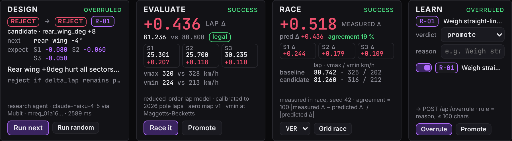
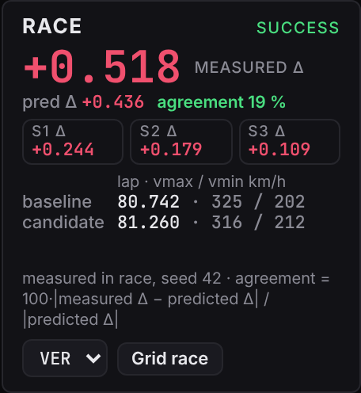
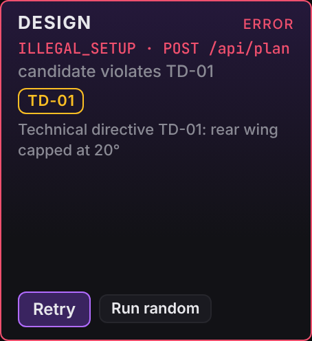
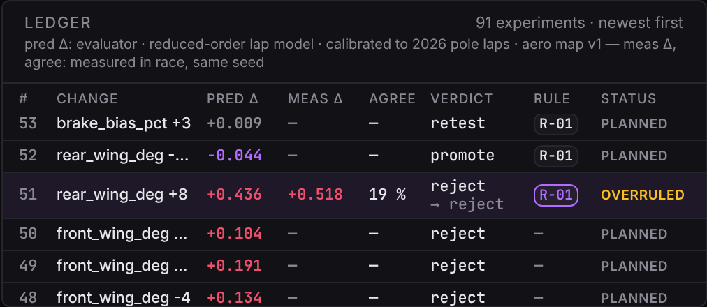

<!-- _paginate: false -->

PURPLE · Night Shift · London · 2026-10-24 · built around Mubit

# 1 · The problem
<small>Setup engineering is a loop of expensive guesses</small>

- An F1 setup is five numbers (wings, ride height, brake bias, ERS); each run is a lap-time bet on the downforce-vs-drag trade.
- The decision that matters is not "was it faster?" but **what to try next**: a bad research direction burns the session.
- Today that judgement lives in a senior engineer's head and leaves with them.
- **PURPLE**: a research agent that **proposes experiments**, is **graded by a deterministic evaluator**, is **checked by a race**, and **learns from the engineer's corrections** through Mubit.

<!--
Speaker notes: The recurring task is the research agent's experiment decision: verdict on the last experiment plus the single next experiment. The evaluator is deterministic, so every decision has a ground truth and "did the correction help?" is a number, not an opinion. Figure: the lab's stage rail, DESIGN EVALUATE RACE LEARN.
-->

---

# 2 · What Mubit does here
<small>One frozen task, every call recorded</small>

- Mubit task **"Research engineer of F1"**: `claude-haiku-4-5`, frozen prompt v1, temperature 0, server-side only.
- Input: baseline setup + lap, candidate setup, the evaluator's lap and sector deltas, active pit-wall rules, last 3 experiments. Output: strict JSON, verdict + next experiment.
- Friday: **57 trained requests → 43 kept examples**, Training v1. Saturday 01:50: **+41 trained calls** with the engineer's rule in every input → v2. Kept after v2: **[≈ 80, from Tasks]**. v1: **[result]**, v2: **[result]** (Adapters tab).
- Corrections do not patch the prompt; they enter the task input as rules, and Mubit trains the next version from the recorded calls.
- **Disclosure:** PURPLE sits on Equation I, our team's pre-existing browser F1 game. The lab, evaluator wrapper and Mubit agent are new tonight.

Mubit console → Tasks / Adapters · data/calls.jsonl (every call with its mreq_ id) · frozen prompt sha 6c5be1a3

<!--
Speaker notes: Equation I is ours and predates the weekend; everything under lab/ and server/ is new. The prompt is frozen by a hash check in the test suite. Figure: console Tasks page showing the task name, 57 requests, 43 kept, Training v1. Owed: the v1 result line from Adapters.
-->

---

# 3 · The loop
<small>DESIGN → EVALUATE → RACE → LEARN</small>

| Stage | What happens | Who |
|---|---|---|
| DESIGN | agent proposes a setup change; `mreq_` id in the trace | Mubit |
| EVALUATE | reduced-order lap model scores it in ms: lap, sectors, vmax, Becketts vmin, legality | evaluator |
| RACE | baseline vs candidate, identical neutral bots, same seed, broadcast camera | the game |
| LEARN | engineer overrules → pit-wall rule → every later task input → adapter v2 | engineer + Mubit |

- Evaluator calibrated so the neutral car laps Silverstone in **80.800 s**, the game's 2026-pole-anchored limit lap.
- The race is the check on the evaluator; the exam is the check on the agent.

reduced-order lap model · calibrated to 2026 pole laps · aero map v1

<!--
Speaker notes: Each stage is a card in the lab and a line in the ledger. The evaluator is the game's own speed-profile lap model with an aero map on top; we label it exactly that, never more. The race measures what the model predicted. Figure: this table, or the lab page with all four cards lit (reference frame docs/agents/integrator-screens/lab-1440-0505-merged.png; re-shoot on the real ledger so the widget is not zeros).
-->

---

# 4 · The numbers
<small>One experiment, end to end · rear wing +8° at Silverstone</small>

| | predicted | measured in race |
|---|---|---|
| lap delta | +0.436 s | +0.518 s |
| top speed | 328.2 → 320.3 km/h | 325.2 → 315.8 km/h |
| Becketts minimum | 212.5 → 223.5 km/h | 201.7 → 211.5 km/h |
| sectors (measured) | | 24.683 / 25.771 / 30.268 → 24.927 / 25.950 / 30.377 |
| agreement | | **19 %** (target ≤ 25 %) |

- Agent's answer: **reject**, next experiment **rear wing · decrease · 4°**. Correct on both.
- Faster through Becketts, slower in every sector: the drag bill is paid on every straight, not one.

left: reduced-order lap model · calibrated to 2026 pole laps · aero map v1 · right: measured in race, seed 42 · ledger 01M5NHXH4RSEQ50VM955FK20B7

<!--
Speaker notes: Two identical neutral bots, seed 42, three laps. The model predicted four tenths, the race measured half a second: 19 percent apart, inside the 25 percent target. No purple sector for this candidate, and the agent knew it before the race. Figure: lab RACE card plus the ledger row.
-->

---

# 5 · v1 vs v2
<small>The story is the next experiment, not the verdict</small>

- Held-out exam, 20 scenarios, truth from the evaluator. Provider: **verdicts 20/20 · next experiment 10/20**; on the 8 hard ones, **8/8 and 1/8**. On all 7 misses the truth is a **ride-height** change; the provider proposes rear wing (5), front wing (1) or brake bias (1) instead.
- **v1 learned from our mistake:** a seeding bug made 94 % of Friday's candidates front-wing moves (39 of 43 answers: "front wing"). Fixed before v2.
- **v2 learns the engineer's rule:** *"Weigh straight-line drag against corner gain; judge on full-lap delta."* in every input; 40 scenarios over all five parameters, verdicts agreeing with the evaluator 38 of 39, ride height proposed 13 times. **Rule-conditioned learning.**

| 8 held-out scenarios (Try models) | provider | v1 | v2 |
|---|---|---|---|
| next experiment | **1/8** | [n/8] | [n/8] |
| verdict | 8/8 | [n/8] | [n/8] |

held-out exam data/exam.json · truth from the reduced-order lap model · provider scored by untrained calls (snapshot 0350-exam-details) · v1/v2 hand-entered from Try models · counts, never %

<!--
Speaker notes: Same unseen scenario to provider, v1 and v2 in Try models, side by side. On these eight the provider gets every verdict and one next step (the demo premise); on all seven misses the truth is a ride-height change and it proposes wings or brake bias instead. Counts, never percentages. If v2 does not beat v1 we show the number anyway. Figure: Try models on exam-rw8, the demo premise, with the version label visible.
-->

---

# 6 · Fast refresh
<small>When the rules or the circuit change, the task keeps collecting</small>

- **Technical directive TD-01** caps the rear wing at 20°. One toggle in the lab.
- A 25° proposal is refused before it reaches the model: "Technical directive TD-01: rear wing capped at 20°", an `illegal` trace line, no Mubit call spent.
- The next legal candidate goes out as usual; new examples count toward the next adapter version.
- **Circuit switch:** at Monza the same rear wing +8° costs +0.757 s (vs +0.436 s at Silverstone). Same task, same prompt, new objective.

reduced-order lap model · calibrated to 2026 pole laps · aero map v1

<!--
Speaker notes: Regulation changes are the normal case in F1. The directive is a legality rule in the aero map, so an illegal candidate never costs a trained call, and the collection continues under the new rules. Monza shows the objective moving without touching the task key. Figure: DESIGN card with the TD-01 violation in red.
-->

---

# 7 · What this is and is not
<small>Honesty slide</small>

- The evaluator is a **reduced-order lap model, calibrated to 2026 pole laps, aero map v1**. It is not a high-fidelity aerodynamic simulation; the race is our only check on it (19 % on the demo candidate).
- Corrections are **rule-conditioned learning**: the rule enters the task input, the provider's answers change, those kept examples train the next adapter version. There is no gradient from the engineer's click.
- Exam scores are **counts** (n/20, n/8), never percentages; truth comes from the evaluator, not from us. v1's data was skewed by our seeding bug; we say so.
- Equation I (game, physics, circuits, drivers) is **pre-existing**; `lab/`, `server/`, the aero map and the Mubit agent are new tonight.
- The grid race is **cinematic · mixes car and driver** (its own caption says so). The baseline-vs-candidate race is the result.

<!--
Speaker notes: We would rather be judged on a small true thing than a large claimed one. Every number on screen carries its source label. The data directory with the ledger and every Mubit request id is frozen into docs/ledger-snapshot at submission. No figure on this slide.
-->

---

# 8 · Next
<small>What a week would add</small>

- **More corrections, more versions:** a correction per session, v3 and v4 scored on the same held-out exam; the exam grows with each new circuit.
- **Richer objective:** wind and wet already in the scenario; add tyre temperature and a stint, not a lap.
- **Grid race as the proving ground:** today Verstappen in the candidate car on the real 2026 British GP grid is a cinematic (P7 → P14 at seed 42, labelled); next, a stint model to make it a measurement.
- **Any team's priors:** the pit-wall rules are plain text; a Formula Student or sim-racing team can train their own research engineer from their own corrections.
- Repo: `github.com/rayhankhilji/purple` · every Mubit request id, ledger row and rule frozen in `docs/ledger-snapshot/`

grid race: cinematic · mixes car and driver · headless run, seed 42 · wind and wet: reduced-order lap model · aero map v1

<!--
Speaker notes: The loop is the product. Everything we would add is more of the same loop: more corrections, more versions, a larger exam, more circuits. Figure: the ledger with the demo row, its rule chip and the measured column. Thank you.
-->
